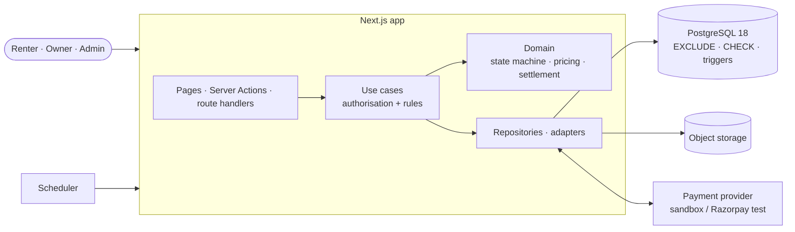
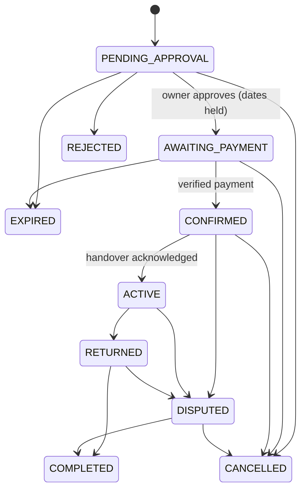
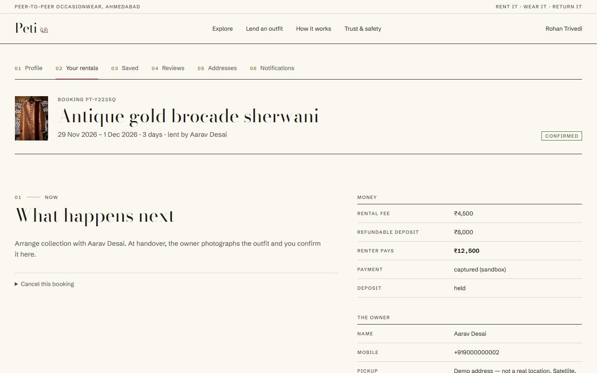
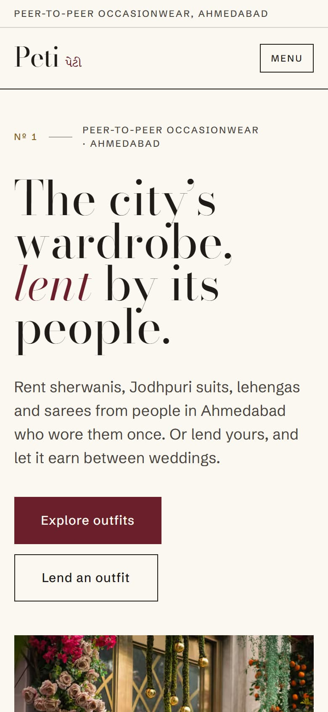

# Peti

**Peti** (પેટી — the trousseau trunk a bride takes to her new home) is an open-source, peer-to-peer
marketplace for renting premium occasionwear in Ahmedabad. People who own a sherwani, Jodhpuri suit, lehenga
or designer saree they wore once can lend it to someone who needs it for a wedding. Owners set the price and
approve every rental; Peti holds the payment and the deposit, keeps the record of the garment's condition,
and earns a commission only on rentals that go ahead. Peti never owns, stores or ships garments.


> **Status:** a working MVP with demonstration data. There are no real users or rentals. Payments run
> through a local sandbox provider (or Razorpay in test mode); no real money moves.

## Why it is built this way

The two direct competitors in Gujarat are classifieds: renters and owners chat, then settle payment,
deposit, damage and refunds between themselves ([competitor research](docs/product/competitor-research.md)).
Peti's hypothesis is that the missing piece is the transaction layer: request-to-book with owner approval,
calendars that cannot double-book, money held and accounted for, condition photographs at handover and
return, and a dispute process. That is what this codebase concentrates on.

## Features

| Area           | What works                                                                                                                                                                                     |
| -------------- | ---------------------------------------------------------------------------------------------------------------------------------------------------------------------------------------------- |
| Accounts       | Sign-up, sign-in, password reset, email confirmation by link, mobile verification by one-time code, profile, addresses, payout UPI ID                                                          |
| Listings       | Create and edit with photographs (sanitised, location data stripped), real measurements, condition, prices for 2/3/5/7 days, deposit, cleaning days; submit for review; pause, resume, archive |
| Discovery      | Keyword search tolerant of misspellings, filters for category, occasion, size, locality, price, chest/waist measurements and dates (shows only outfits free on those dates)                    |
| Booking        | Date picker with held dates struck out, live price breakdown, request → owner approval → payment window → confirmation only after verified payment                                             |
| Rental         | Handover report with photographs, renter acknowledgement, return report, late fees, 48-hour inspection window, automatic completion                                                            |
| Money          | Integer paise everywhere; rental fee, deposit, commission, refunds and payouts recorded separately; refunds sent through an outbox; a reconciliation view proves every closed booking balances |
| Cancellations  | Renter tiers (full / half / none by notice), owner cancellations refunded in full and counted                                                                                                  |
| Trust          | Double-blind reviews after completion, disputes (accept, withdraw, administrator decision), contact details revealed only after payment, no identity documents collected                       |
| Administration | Overview metrics, listing moderation, users (suspend/reinstate), bookings, disputes, payouts (mark paid with reference), failed-refund retry, categories, append-only activity log           |
| Operations     | Idempotent sweep for deadlines, refunds, emails and reviews; dev outbox for emails and codes; sandbox checkout that signs callbacks and webhooks like a real provider                          |

## Architecture

A modular monolith: one Next.js 16 application and one PostgreSQL 18 database
([system architecture](docs/architecture/system-architecture.md), [ADR-002](docs/decisions/ADR-002-modular-monolith.md)).



- **Layers are enforced by tooling.** dependency-cruiser fails CI if domain code imports a framework or the
  ORM, if a use case reaches an adapter, or if a module reaches into another module's internals.
- **No double booking, by construction.** Approval inserts a calendar hold guarded by a PostgreSQL
  `EXCLUDE USING gist` constraint over date ranges; owner blocks use the same constraint
  ([ADR-004](docs/decisions/ADR-004-booking-concurrency.md)).
- **Confirmed means paid.** The only path to `CONFIRMED` is a capture verified with the provider; the browser
  callback and the webhook are both idempotent and race-safe
  ([payment architecture](docs/architecture/payment-architecture.md)).
- **The database is the last line of defence.** Money identities, legal status transitions, append-only
  history and audit, one open dispute per booking — all enforced by named constraints and triggers
  ([database design](docs/architecture/database-design.md)).

### Booking lifecycle



## Screenshots

|                                                  |                                                |
| ------------------------------------------------ | ---------------------------------------------- |
|  |  |
|  |     |

## Run it locally

Requirements: Node 24, pnpm 10, Docker.

```bash
git clone https://github.com/kuldeepsinh19/peti.git && cd peti
pnpm install                      # also generates the Prisma client
cp .env.example .env              # then replace the placeholder secrets
docker compose up -d              # PostgreSQL 18 (+ a peti_test database)
pnpm db:migrate                   # apply migrations
pnpm db:seed                      # localities, categories, demo accounts and listings
pnpm dev                          # http://localhost:3000
```

Demo accounts (fictional) all use the password `peti-demo-password`: `admin@peti.local`,
`aarav@peti.local`, `meera@peti.local`, `kabir@peti.local`, `isha@peti.local`, `rohan@peti.local`.
Emails and one-time codes appear at `/dev/outbox`; payments go through `/dev/sandbox-checkout`.
Full guide: [local setup](docs/development/local-setup.md).

## Tests

```bash
pnpm check                 # lint, types, architecture boundaries, unit and component tests
pnpm db:test:prepare       # migrate the peti_test database
pnpm test:integration      # use cases and database guards against real PostgreSQL
pnpm build && pnpm test:e2e
```

Highlights: an exhaustive state-machine test, property tests that settlement always conserves money, a
two-connection test of the exclusion constraint, ten concurrent approvals of which exactly one wins, the
browser callback racing the webhook, tampered and duplicate webhooks, a capture arriving after expiry, and
end-to-end journeys in Chromium. See the [testing guide](docs/development/testing-guide.md).

## Documentation

|              |                                                                                                                                                                                                                                                                                                                                                                              |
| ------------ | ---------------------------------------------------------------------------------------------------------------------------------------------------------------------------------------------------------------------------------------------------------------------------------------------------------------------------------------------------------------------------- |
| Product      | [Requirements](docs/product/product-requirements.md) · [Personas](docs/product/user-personas.md) · [Journeys](docs/product/user-journeys.md) · [Business model](docs/product/business-model.md) · [Competitors](docs/product/competitor-research.md) · [Assumptions and risks](docs/product/assumptions-and-risks.md) · [Design direction](docs/product/design-direction.md) |
| Architecture | [System](docs/architecture/system-architecture.md) · [Database](docs/architecture/database-design.md) · [Booking lifecycle](docs/architecture/booking-lifecycle.md) · [Payments](docs/architecture/payment-architecture.md) · [Security](docs/architecture/security-architecture.md)                                                                                         |
| Decisions    | [ADR-001 stack](docs/decisions/ADR-001-technology-stack.md) · [ADR-002 modular monolith](docs/decisions/ADR-002-modular-monolith.md) · [ADR-003 database](docs/decisions/ADR-003-database-design.md) · [ADR-004 concurrency](docs/decisions/ADR-004-booking-concurrency.md) · [ADR-005 payments](docs/decisions/ADR-005-payment-abstraction.md)                              |
| API          | [Overview](docs/api/api-overview.md) · [Errors](docs/api/error-handling.md)                                                                                                                                                                                                                                                                                                  |
| Development  | [Local setup](docs/development/local-setup.md) · [Testing](docs/development/testing-guide.md) · [Deployment](docs/development/deployment-guide.md) · [CLAUDE.md](CLAUDE.md) · [Contributing](CONTRIBUTING.md) · [Security policy](SECURITY.md)                                                                                                                               |

## Known limitations

- No real money: the sandbox provider is for local and test use, and the Razorpay adapter accepts test
  keys only. Owner payouts are recorded and marked paid by an administrator; automated settlement needs a
  marketplace product such as Razorpay Route.
- SMS codes are delivered to the dev outbox. There is no SMS provider yet, so `APP_ENV=production` refuses
  to start until one (with DLT registration) is added.
- An independent security review found issues that were fixed with regression tests; a few lower-risk
  items remain open and are listed in the [security architecture](docs/architecture/security-architecture.md#review-findings-and-fixes).
- Identity verification is an interface only; nobody is ever shown as identity-verified.
- Terms and privacy pages are drafts that need legal review; GST and TDS are not modelled.
- One city. No in-app chat, delivery or insurance.

## Licence

Code is [MIT](LICENSE). Photographs are not covered by the code licence; each stays under its source licence
(see [public/images/ATTRIBUTION.md](public/images/ATTRIBUTION.md)). Demo listings and people are fictional.
