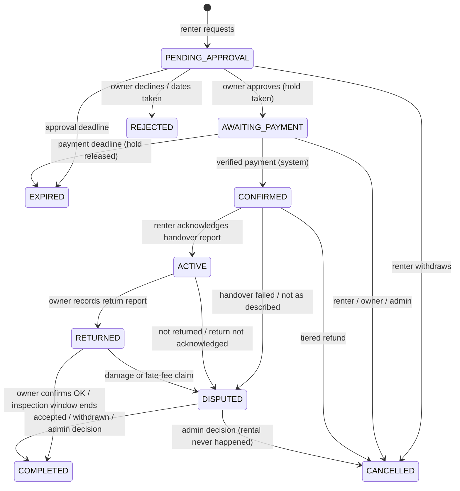

# Booking lifecycle

The booking state machine is the core of Peti. It lives in
`src/modules/bookings/domain/booking-state-machine.ts` as a typed transition table; every status change goes
through `applyTransition`, which performs a compare-and-swap update, writes `booking_status_history`, applies
side effects (calendar holds, money) in the same transaction and queues notifications. A database trigger
rejects any status change that is not in `booking_allowed_transitions`, which is seeded from the same table
(a test asserts the two are equal).

## States

| State              | Meaning                                                           | Holds the calendar     |
| ------------------ | ----------------------------------------------------------------- | ---------------------- |
| `PENDING_APPROVAL` | Renter has requested dates; owner has not answered                | No                     |
| `AWAITING_PAYMENT` | Owner approved; renter must pay within the payment window         | **Yes**                |
| `CONFIRMED`        | Provider-confirmed payment received; deposit held                 | Yes                    |
| `ACTIVE`           | Garment handed over (renter acknowledged the handover report)     | Yes                    |
| `RETURNED`         | Owner recorded the return; 48-hour inspection window running      | Yes                    |
| `DISPUTED`         | A dispute is open; money is frozen until it resolves              | Yes                    |
| `COMPLETED`        | Settled: deposit released or withheld, refund and payout recorded | Yes (keeps the buffer) |
| `CANCELLED`        | Withdrawn or cancelled by a participant or admin                  | No                     |
| `REJECTED`         | Owner declined, or dates became unavailable                       | No                     |
| `EXPIRED`          | Approval or payment deadline passed                               | No                     |

`COMPLETED`, `CANCELLED`, `REJECTED` and `EXPIRED` are terminal.

### How this differs from the suggested list

| Suggested                   | Decision         | Reason                                                                                                   |
| --------------------------- | ---------------- | -------------------------------------------------------------------------------------------------------- |
| DRAFT                       | Removed          | A form state; persisting it creates rows with no invariant to enforce.                                   |
| APPROVED + AWAITING_PAYMENT | Merged           | No actor acts between them; `approved_at` records the moment.                                            |
| READY_FOR_PICKUP            | Removed          | No platform logistics; shown as a UI label for confirmed bookings near the start date.                   |
| OUTFIT_COLLECTED + ACTIVE   | Merged           | Acknowledging the handover _is_ the collection.                                                          |
| RETURN_PENDING              | Derived          | `ACTIVE` and today after the end date means overdue; a clock-driven state adds a job but no permissions. |
| —                           | Added `REJECTED` | Different message and metric from a cancellation.                                                        |
| —                           | Added `EXPIRED`  | Deadlines lapse without any actor.                                                                       |

## Diagram

## Transition table

Actors: `RENTER` (the booking's renter), `OWNER` (the outfit's owner), `ADMIN`, `SYSTEM` (sweep job or
payment pipeline). Admin use of any transition requires a reason and writes an audit log entry.

| From → To                           | Command                                              | Actor                                                                                                    | Guards                                                                                                                                                                                                                               | Effects                                                                                                                |
| ----------------------------------- | ---------------------------------------------------- | -------------------------------------------------------------------------------------------------------- | ------------------------------------------------------------------------------------------------------------------------------------------------------------------------------------------------------------------------------------ | ---------------------------------------------------------------------------------------------------------------------- |
| — → PENDING_APPROVAL                | `requestBooking`                                     | renter                                                                                                   | not the owner; outfit `ACTIVE`; renter active and phone-verified; duration is an active price option; start between tomorrow (IST) and +180 days; dates free (advisory); one pending request per outfit/renter/start; terms accepted | pricing and policy snapshot frozen; approval deadline set                                                              |
| PENDING_APPROVAL → AWAITING_PAYMENT | `approveBooking`                                     | owner                                                                                                    | before deadline; outfit `ACTIVE`; hold insert succeeds                                                                                                                                                                               | outfit row locked; hold `[start, end+1+buffer)`; payment deadline set; conflict → `DATES_UNAVAILABLE`, nothing changes |
| PENDING_APPROVAL → REJECTED         | `rejectBooking`                                      | owner, admin                                                                                             | —                                                                                                                                                                                                                                    | reason `OWNER_DECLINED`                                                                                                |
| PENDING_APPROVAL → REJECTED         | auto                                                 | system                                                                                                   | an overlapping booking was confirmed, or the owner blocked the dates                                                                                                                                                                 | reason `DATES_UNAVAILABLE`                                                                                             |
| PENDING_APPROVAL → CANCELLED        | `withdrawRequest`                                    | renter, admin                                                                                            | —                                                                                                                                                                                                                                    | no money involved                                                                                                      |
| PENDING_APPROVAL → EXPIRED          | sweep                                                | system                                                                                                   | approval deadline passed                                                                                                                                                                                                             | reason `APPROVAL_TIMEOUT`                                                                                              |
| AWAITING_PAYMENT → CONFIRMED        | `confirmPayment`                                     | system only                                                                                              | verified capture; amount equals renter total; INR                                                                                                                                                                                    | deposit `HELD`; overlapping pending requests auto-rejected; contact details revealed                                   |
| AWAITING_PAYMENT → EXPIRED          | sweep                                                | system                                                                                                   | payment deadline passed; provider polled first (if paid, confirm instead)                                                                                                                                                            | hold deleted; payment `ABANDONED`                                                                                      |
| AWAITING_PAYMENT → CANCELLED        | `cancelBooking`                                      | renter, owner, admin                                                                                     | no captured payment                                                                                                                                                                                                                  | hold deleted; a later capture is refunded in full automatically                                                        |
| CONFIRMED → ACTIVE                  | `acknowledgeHandover`                                | renter (admin override)                                                                                  | owner's handover report with ≥ 3 photos exists; today ≥ start − 1                                                                                                                                                                    | handover report locked                                                                                                 |
| CONFIRMED → CANCELLED               | `cancelBooking`                                      | renter                                                                                                   | not handed over                                                                                                                                                                                                                      | fee refunded by tier; deposit refunded in full; payout for any retained fee                                            |
| CONFIRMED → CANCELLED               | `cancelBooking`                                      | owner                                                                                                    | not handed over                                                                                                                                                                                                                      | full refund; no payout; owner cancellation counted                                                                     |
| CONFIRMED → CANCELLED               | `cancelBooking`                                      | admin                                                                                                    | reason and explicit refund split                                                                                                                                                                                                     | as chosen                                                                                                              |
| CONFIRMED → DISPUTED                | `openDispute`                                        | renter, owner, admin                                                                                     | today ≥ start; no open dispute                                                                                                                                                                                                       | dispute opened                                                                                                         |
| ACTIVE → RETURNED                   | `recordReturn`                                       | owner (admin override)                                                                                   | return report with photos                                                                                                                                                                                                            | late days and late fee computed (capped at deposit); inspection deadline = now + 48 h                                  |
| ACTIVE → DISPUTED                   | `openDispute`                                        | owner (not returned, after end date), renter (return not acknowledged), system (> 3 days overdue), admin | no open dispute                                                                                                                                                                                                                      | dispute opened                                                                                                         |
| RETURNED → COMPLETED                | `confirmReturn` / sweep                              | owner / system at inspection deadline                                                                    | no open dispute                                                                                                                                                                                                                      | settlement: deposit released (minus late fee), refund and payout rows created                                          |
| RETURNED → DISPUTED                 | `openDispute`                                        | owner (damage, missing items), renter (late fee contested)                                               | inside inspection window; claim ≤ deposit − late fee; evidence                                                                                                                                                                       | deposit stays held                                                                                                     |
| DISPUTED → COMPLETED                | `acceptClaim` / `withdrawDispute` / `resolveDispute` | respondent / opener / admin                                                                              | admin sets withheld deposit and rental refund explicitly, with notes                                                                                                                                                                 | settlement with those amounts                                                                                          |
| DISPUTED → CANCELLED                | `resolveDispute`                                     | admin                                                                                                    | the rental never effectively happened                                                                                                                                                                                                | explicit refund split; hold deleted                                                                                    |

## Policy defaults

Configured in `src/config/marketplace-policy.ts` and **snapshotted onto each booking**, so later policy
changes never alter an existing agreement. These are product assumptions, not legal advice.

| Topic                        | Default                                                                                        |
| ---------------------------- | ---------------------------------------------------------------------------------------------- |
| Duration options             | Owner prices any of 2, 3, 5 or 7 days; a booking uses exactly one                              |
| Booking window               | Start from tomorrow (IST) up to 180 days ahead                                                 |
| Owner response window        | 24 hours, or 18:00 IST the day before the start date if earlier                                |
| Payment window               | 12 hours after approval, but no later than 12 hours before the start date                      |
| Commission                   | 15% of the rental fee (1500 basis points, half-up rounding), owner side only                   |
| Deposit                      | Owner-set, minimum ₹500, maximum the declared retail value                                     |
| Turnaround buffer            | 1 day after each rental; owner may set 0–7                                                     |
| Renter cancels after payment | Deposit 100% back; rental fee 100% if ≥ 7 days before start, 50% if 48 h–7 days, 0% if < 48 h  |
| Owner cancels after payment  | Renter gets everything back; no payout; cancellation counted                                   |
| Late return                  | 1.5 × the daily rate per late day, from the deposit, capped at the deposit                     |
| Inspection window            | 48 hours after the return is recorded; silence means auto-complete                             |
| Damage claim                 | Up to the deposit minus any late fee; the deposit is the most the platform can recover         |
| Reviews                      | Both participants, within 14 days of completion; hidden until both submit or the window closes |
| Contact details              | Phone and pickup address shown to the counterparty only from `CONFIRMED`                       |

## Scenarios

- **Overlapping requests.** All may be pending at once. The first approval takes the hold; approving a
  second overlapping request fails with `DATES_UNAVAILABLE` and the owner sees which booking blocks it. When
  the winner is confirmed, the remaining overlapping requests are rejected automatically.
- **Payment window expiry.** The sweep (and an opportunistic check before approvals) expires the booking,
  deletes the hold and frees the dates. It first asks the provider whether the order was paid, so a payment
  that raced the deadline still confirms.
- **Payment after expiry or cancellation.** The payment is recorded as captured and a full refund is queued
  (`LATE_CAPTURE_REVERSAL`). The booking stays in its terminal state.
- **Late return.** Not a state. `returned_on > end_date` produces late days and a late fee deducted from the
  deposit. More than three days overdue opens a `NOT_RETURNED` dispute automatically.
- **Damage.** The owner files a claim with photos inside the inspection window. The renter can accept (instant
  settlement) or contest, in which case an admin decides using the handover and return reports.

Money for each exit is described in [payment-architecture.md](./payment-architecture.md).
