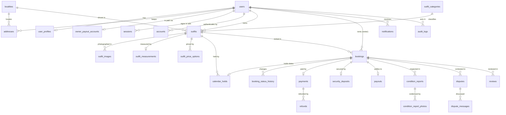

# Database design

PostgreSQL 18, accessed through Prisma 7 (`@prisma/adapter-pg`). The schema is `prisma/schema.prisma`;
everything Prisma cannot express lives in hand-written migrations. Decisions:
[ADR-003](../decisions/ADR-003-database-design.md) (integrity first) and
[ADR-004](../decisions/ADR-004-booking-concurrency.md) (no double booking).

## Conventions

| Topic            | Rule                                                                                      |
| ---------------- | ----------------------------------------------------------------------------------------- |
| Names            | Tables and columns `snake_case` (`@@map`/`@map`), models PascalCase singular              |
| Keys             | `uuid` primary keys (`gen_random_uuid()`); `int` identity only for append-only logs       |
| Money            | Integer paise (`integer`), never floats; rates in basis points                            |
| Calendar days    | `date`, mapped to the `LocalDate` value object; "today" is computed in Asia/Kolkata       |
| Instants         | `timestamptz(3)`                                                                          |
| Measurements     | Integer millimetres in typed columns (not key/value rows), so range filters are plain SQL |
| Constraint names | Explicit, because `pg-error.ts` maps them to domain errors                                |

## Entity relationships

Supporting tables: `verifications`, `auth_rate_limits` (Better Auth), `app_rate_limits` (application limiter),
`provider_events` (webhook inbox), `booking_allowed_transitions` (seeded transition table),
`saved_outfits`, `dev_outbox_messages` and `sandbox_provider_objects` (local/test only).

## Tables by area

| Area       | Tables                                                                                                          | Notes                                                                                                                                                                                                             |
| ---------- | --------------------------------------------------------------------------------------------------------------- | ----------------------------------------------------------------------------------------------------------------------------------------------------------------------------------------------------------------- |
| Identity   | `users`, `sessions`, `accounts`, `verifications`, `auth_rate_limits`                                            | Owned by Better Auth. `role` is `user`/`admin`; `phone_number` must match `+91[6-9]\d{9}`. `identity_verification_status` defaults to `UNVERIFIED` and nothing in the MVP changes it. No ID documents are stored. |
| People     | `user_profiles`, `addresses`, `owner_payout_accounts`, `localities`                                             | Ratings stored as integer sums and counts. One default address per user (partial unique index).                                                                                                                   |
| Catalogue  | `outfit_categories`, `outfits`, `outfit_images`, `outfit_measurements`, `outfit_price_options`, `saved_outfits` | Deposit between ₹500 and the retail value. `min_price_paise` is denormalised for sorting. Live listings must have a price.                                                                                        |
| Calendar   | `calendar_holds`                                                                                                | One row per held range (`BOOKING` or `OWNER_BLOCK`), half-open `[starts_on, ends_before)`, protected by `calendar_holds_no_overlap`.                                                                              |
| Bookings   | `bookings`, `booking_status_history`, `booking_allowed_transitions`                                             | Price, deposit, commission, totals and policy are snapshotted at request time and immutable afterwards.                                                                                                           |
| Money      | `payments`, `refunds`, `security_deposits`, `payouts`, `provider_events`                                        | One payment per booking; refunds are an outbox; deposit status consistent with the amount withheld; payout net identity.                                                                                          |
| Trust      | `condition_reports`, `condition_report_photos`, `disputes`, `dispute_messages`, `reviews`                       | One report per kind per booking; one open dispute per booking; one review per author per booking.                                                                                                                 |
| Operations | `notifications`, `audit_logs`, `app_rate_limits`                                                                | Notifications double as the email outbox; audit log is append-only.                                                                                                                                               |

## Constraints that carry business rules

All in `prisma/migrations/*_integrity_constraints/migration.sql` (plus the two later migrations).

| Constraint / object                                                                                  | Rule                                                                                                                          |
| ---------------------------------------------------------------------------------------------------- | ----------------------------------------------------------------------------------------------------------------------------- |
| `calendar_holds_no_overlap`                                                                          | `EXCLUDE USING gist (outfit_id WITH =, daterange(starts_on, ends_before,'[)') WITH &&)` — no two holds overlap for one outfit |
| `bookings_owner_not_renter`                                                                          | Nobody rents their own outfit                                                                                                 |
| Composite FK `bookings(outfit_id, owner_id) → outfits(id, owner_id)`                                 | A booking's owner is the outfit's owner                                                                                       |
| Composite FK `calendar_holds(booking_id, outfit_id) → bookings(id, outfit_id)`                       | A hold covers its own booking's outfit                                                                                        |
| `bookings_dates_valid`, `bookings_buffer_range`                                                      | `rental_days = end − start + 1`; buffer 0–7                                                                                   |
| `bookings_renter_total_identity`, `bookings_owner_payout_identity`, `bookings_commission_within_fee` | Totals add up                                                                                                                 |
| `bookings_closed_reason_matches_status`                                                              | Closed bookings always say why                                                                                                |
| `bookings_guard_status` trigger                                                                      | New bookings start `PENDING_APPROVAL`; status changes must be in `booking_allowed_transitions`                                |
| `bookings_guard_snapshot` trigger                                                                    | Parties, dates and pricing never change after insert                                                                          |
| `bookings_one_pending_request`                                                                       | One pending request per renter, outfit and start date                                                                         |
| `payments_refunded_within_amount`, `payments_refund_requires_capture`                                | Never refund more than captured, nor before capture                                                                           |
| `refunds_amounts_valid`, `refunds_one_per_payment_reason`                                            | Refund portions add up; no double settlement                                                                                  |
| `security_deposits_status_consistent`                                                                | `RELEASED` ⇔ nothing withheld; `FORFEITED` ⇔ all withheld                                                                     |
| `payouts_net_identity`, `payouts_paid_consistent`                                                    | `net = gross − commission + withheld`; paid ⇔ reference and payer recorded                                                    |
| `disputes_one_open_per_booking`                                                                      | One open dispute at a time                                                                                                    |
| `reviews_rating_range`, `reviews_not_self`                                                           | 1–5 stars; no self-review                                                                                                     |
| Append-only triggers                                                                                 | `booking_status_history` and `audit_logs` reject UPDATE and DELETE                                                            |
| `v_booking_money_reconciliation`                                                                     | For each closed, paid booking: `captured − refunded − payout − commission` (must be 0)                                        |

## Indexes for discovery

Partial indexes restricted to `status = 'ACTIVE'`: category + price, locality, size, occasions (GIN),
full-text (`outfit_search_document()` with the `'simple'` configuration, GIN) and trigram on `lower(title)`.
Deadline scans for the sweep use partial indexes on `expires_at` and `inspection_deadline`. At MVP scale
these are sufficient; add more only when `EXPLAIN` shows a need.

## Locking and isolation

READ COMMITTED throughout. Hold-taking commands lock the outfit row (`FOR NO KEY UPDATE`), then the booking
(`FOR UPDATE`), then the payment. Calendar holds are inserted with
`ON CONFLICT ON CONSTRAINT calendar_holds_no_overlap DO NOTHING`, so a conflict does not abort the
transaction. Deadlocks and serialisation failures are retried twice, then reported as `CONCURRENT_UPDATE`.

## Verified behaviour

- Prisma does not treat the hand-written objects as drift (`pnpm db:drift` is empty; CI enforces it).
- Prisma 7's pg adapter drops the `constraint` field of Postgres errors; names are read from the message.
- `tests/integration/database/guards.test.ts` bypasses the application and shows each guard rejecting
  invalid data, including a two-connection test of the exclusion constraint.
- Replacing `calendar_holds_no_overlap` with a same-named constraint that never conflicts makes the concurrency tests fail (10 of 10 concurrent approvals
  "win"), which shows the tests depend on the constraint.

## Migrations

| Migration                  | Purpose                                                                                                       |
| -------------------------- | ------------------------------------------------------------------------------------------------------------- |
| `init`                     | Tables, enums, foreign keys and indexes generated from the schema                                             |
| `integrity_constraints`    | Extensions, EXCLUDE, CHECKs, partial indexes, triggers, search function, reconciliation view, transition seed |
| `trigger_error_names`      | Trigger errors start with their constraint name (for error mapping)                                           |
| `saree_length_measurement` | Garment length up to 10 m (sarees are measured end to end)                                                    |
| `payout_net_may_be_zero`   | A payout may net to zero (it still records the commission); found by the settlement property test             |

Never edit an applied migration; add a new one. Prisma refuses `migrate reset` when an AI agent runs it, and
the test database is prepared with the non-destructive `migrate deploy`.
