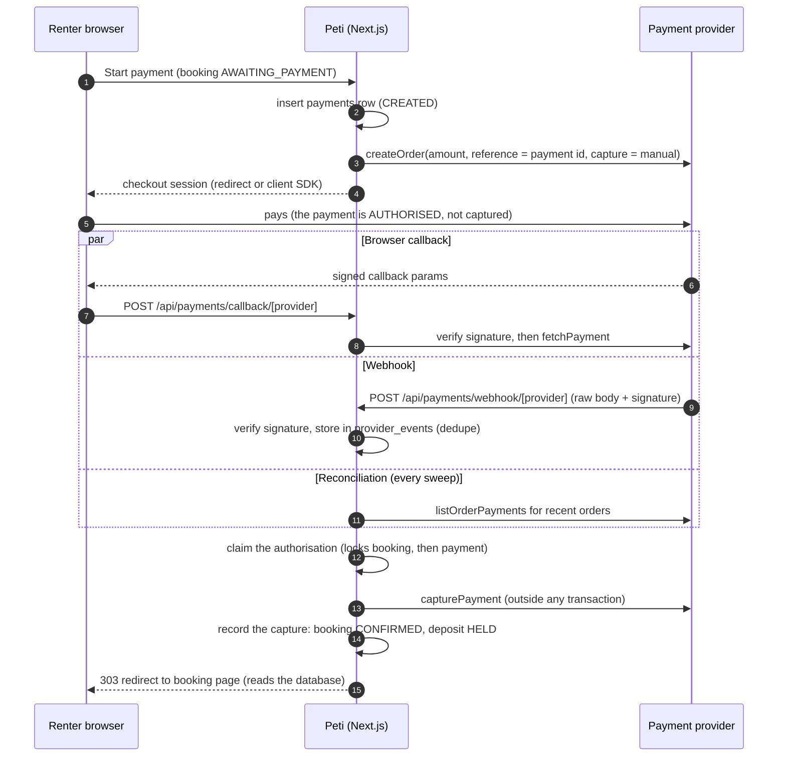
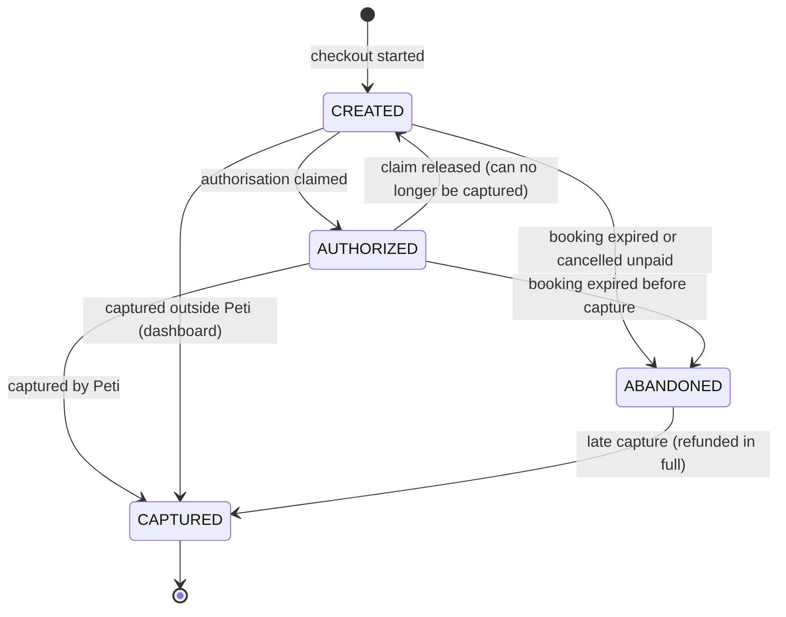
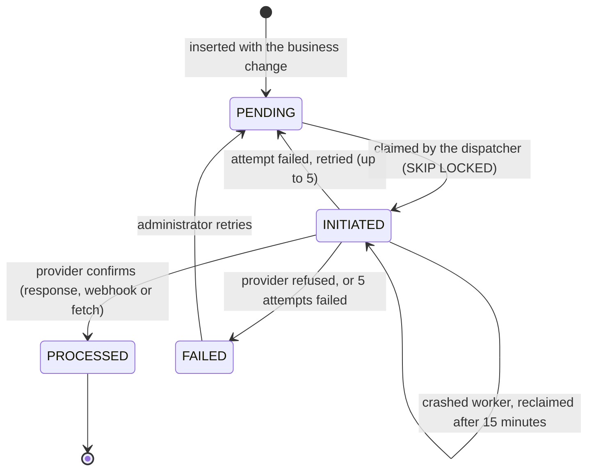
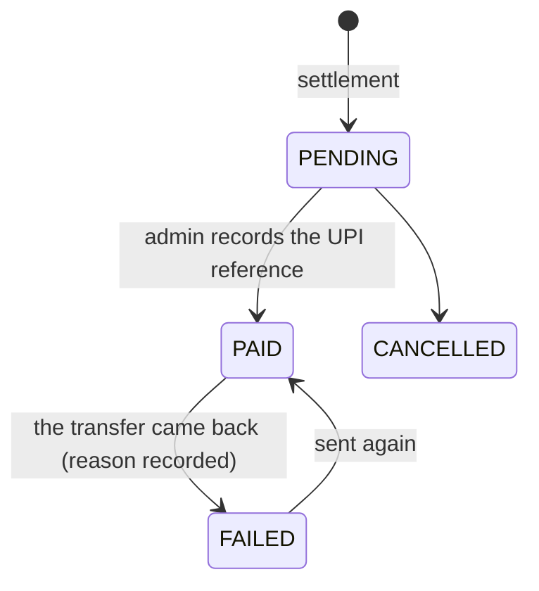

# Payment architecture

Decision records: [ADR-005](../decisions/ADR-005-payment-abstraction.md) (the port and the money model) and
[ADR-006](../decisions/ADR-006-payment-reliability.md) (explicit capture, reversals, reconciliation). Booking
states referred to here are described in [booking-lifecycle.md](./booking-lifecycle.md).

**Status.** Everything on this page is verified end to end with the sandbox provider. The Razorpay adapter
follows Razorpay's documentation and is unit-tested against a stubbed SDK; it has never been run against
Razorpay.

## Money rules

- All amounts are **integer paise** (`Paise`), stored in `integer` columns with CHECK constraints.
- Rates are basis points. Commission = `round_half_up(fee × bps / 10000)`, computed in one function.
- Pricing is **snapshotted on the booking** at request time and never changes afterwards.

| Snapshot column                                   | Meaning                                       |
| ------------------------------------------------- | --------------------------------------------- |
| `rental_days`, `rental_fee_paise`                 | The chosen duration option and its price      |
| `deposit_paise`                                   | Outfit deposit at request time                |
| `commission_rate_bps`, `commission_paise`         | Commission on the full fee (quoted)           |
| `renter_total_paise`                              | `rental_fee + deposit` — the amount charged   |
| `owner_payout_paise`                              | `rental_fee − commission` — the quoted payout |
| `late_fee_per_day_paise`                          | `ceil(1.5 × rental_fee / rental_days)`        |
| `buffer_days`, `terms_version`, `policy_snapshot` | The frozen rules both sides agreed to         |

## Flow

Peti captures explicitly: an order is created for **manual capture**, so an authorised payment becomes money
only when Peti captures it, and Peti captures one payment per booking.



Every report of a payment — callback, webhook or reconciliation — goes through one function,
`applyProviderPayment` (`modules/payments/application/payments.ts`):

| Provider says | Peti does                                                                                |
| ------------- | ---------------------------------------------------------------------------------------- |
| `AUTHORIZED`  | Claim it for the booking, capture it, record the capture. Or decline it and leave it be. |
| `CAPTURED`    | Record the capture: confirm, refund as late, or reverse.                                 |
| `FAILED`      | Store the failure reason. A failure never downgrades a captured payment.                 |
| `REFUNDED`    | Nothing: it can never apply to a booking.                                                |

**Claim** (`claimAuthorization`, `modules/bookings/application/payment-events.ts`). Under the booking and
payment row locks, an authorisation is claimed only if the booking is `AWAITING_PAYMENT`, the payment row is
`CREATED`, and the amount and currency are exact. The row becomes `AUTHORIZED` with that provider payment id.
A second authorisation, a wrong amount or a closed booking is **declined**: an audit entry
(`payment.authorizationDeclined`) is written, the authorisation is never captured, and the provider returns
it to the payer when the capture window (24 hours) ends.

**Capture.** The provider call runs outside any database transaction. If it fails, Peti asks the provider
for the payment: if it was captured after all (a lost response, or a concurrent caller), the capture is
recorded; if it can no longer be captured, the claim is released so the renter can pay again; otherwise the
error is stored (`capture_attempts`, `last_capture_error`) and the sweep retries every 15 minutes. While a
payment is `AUTHORIZED`, starting checkout again is refused (`PAYMENT_PROCESSING`). A booking whose payment is
`AUTHORIZED` at the payment deadline is kept for one more hour while the capture is retried; after that it
expires and the authorisation is left for the provider to return.

**Record** (`recordCapturedPayment`) is the **only** path to `CONFIRMED`:

1. Lock the booking, then the payment (`FOR UPDATE`).
2. Already `CAPTURED` with the same provider payment id → nothing to do (another signal won the race).
3. Already `CAPTURED` with a **different** provider payment id, or the amount or currency differs → queue a
   **reversal**: a refund of exactly that provider payment (below). The booking is untouched.
4. Otherwise mark the payment `CAPTURED`. If the booking is `AWAITING_PAYMENT`, confirm it and create the
   deposit (`HELD`). If not, queue a full refund (`LATE_CAPTURE_REVERSAL`).

The callback route is authenticated by signature only (the provider's POST is cross-site, so session cookies
may be absent). A signature proves the checkout finished, not that money moved, so the server always fetches
the payment from the provider and never renders success from query parameters.



## Webhook inbox

1. Read the raw body (`request.text()`).
2. `provider.parseWebhook` verifies the signature. Invalid → `401`, nothing stored.
3. Insert into `provider_events` with `ON CONFLICT (provider, provider_event_id) DO NOTHING`. Already
   processed → `200 duplicate`.
4. Process; mark `PROCESSED`, or `FAILED` and return `500` so the provider retries.

Events handled: `payment.authorized`, `payment.captured` / `order.paid`, `payment.failed`,
`refund.processed`, `refund.failed`, and `payment.dispute.created|won|lost|closed`. Everything else is
stored as `IGNORED`.

## Reconciliation

Webhooks can be lost, so every sweep also asks the provider directly.

| What     | Which rows                                                             | How often                                       | Then                                    |
| -------- | ---------------------------------------------------------------------- | ----------------------------------------------- | --------------------------------------- |
| Payments | Orders created in the last 6 days                                      | Hourly; every 15 minutes while `AUTHORIZED`     | `listOrderPayments` → the same pipeline |
| Refunds  | `INITIATED` with a provider refund id                                  | 30 minutes after sending, then every 30 minutes | `fetchRefund` → settle                  |
| Expiry   | A booking about to expire unpaid (inside the booking sweep, as before) | Once, before expiring                           | `listOrderPayments` → the same pipeline |

Six days is longer than an uncaptured authorisation can live (24 hours here, 5 days at most), so nothing can
be captured on an older order. The throttle uses database time (`payments.last_reconciled_at`).

## Settlement

One pure function (`deposits/domain/settlement.ts`) handles every exit. Inputs: the rental fee retained `F`
(0 to fee) and the deposit withheld `W` (0 to deposit).

| Output             | Formula                                                                        |
| ------------------ | ------------------------------------------------------------------------------ |
| Refund to renter   | `(fee − F) + (deposit − W)`                                                    |
| Commission         | `round_half_up(F × bps / 10000)`                                               |
| Owner payout (net) | `F − commission + W` (no payout row when `F = W = 0`)                          |
| Deposit status     | `RELEASED` if `W = 0`, `FORFEITED` if `W = deposit`, else `PARTIALLY_WITHHELD` |

Deposit deductions (late fee, damage) go to the owner in full; commission applies only to the retained
rental fee.

| Exit                           | F          | W                |
| ------------------------------ | ---------- | ---------------- |
| Completed, no claim            | fee        | late fee         |
| Renter cancels ≥ 7 days before | 0          | 0                |
| Renter cancels 48 h–7 days     | 50% of fee | 0                |
| Renter cancels < 48 h          | fee        | 0                |
| Owner cancels                  | 0          | 0                |
| Claim accepted                 | fee        | late fee + claim |
| Admin decision                 | as decided | as decided       |

**Conservation invariant**, asserted in tests and visible to admins through
`v_booking_money_reconciliation`: for every closed booking with a captured payment,

```
captured = refunded + owner payout (net) + commission
```

Reversals are not part of it: that money was never the booking's. They are listed in
`v_unexpected_captures`, with whether the refund has gone back.

## Refunds

Refund rows are their own outbox. The business transaction inserts the row as `PENDING`. After commit, the
sweep sends pending refunds to the provider using the refund id as the idempotency reference. Provider calls
never happen inside a database transaction.



| Reason                        | Refunds                                       | Counts in `refunded_paise` |
| ----------------------------- | --------------------------------------------- | -------------------------- |
| `CANCELLATION`                | Per the cancellation policy                   | Yes                        |
| `DEPOSIT_RELEASE`             | The deposit, less anything withheld           | Yes                        |
| `DISPUTE_RESOLUTION`          | As accepted or decided                        | Yes                        |
| `LATE_CAPTURE_REVERSAL`       | Everything: the booking had stopped waiting   | Yes                        |
| `UNEXPECTED_CAPTURE_REVERSAL` | A stray provider payment, in full (see below) | No                         |

- Settlement refunds are split into `rental_fee_portion` and `deposit_portion` and increment
  `payments.refunded_paise` (a CHECK keeps it at or below the captured amount).
- A **reversal** names the stray payment in `reversed_provider_payment_id`; a partial unique index allows one
  per provider payment, so racing reports queue it once. The dispatcher refunds
  `COALESCE(reversed_provider_payment_id, payments.provider_payment_id)`.
- A webhook settles a refund by **provider refund id**, or by **our reference** while the provider id was
  never stored (a worker died after sending it). A late webhook about a failed attempt cannot touch a retry:
  the retry forgets the failed attempt's provider id.
- Writes back from the dispatcher are compare-and-swap on `INITIATED`; a refund already settled by a webhook
  is never undone.
- Every state change writes an audit entry (`refund.sent`, `refund.processed`, `refund.failed`,
  `refund.retry`) in the same transaction.

## Payouts

A payout row (`PENDING`) is created at settlement; `payouts.booking_id` is unique, so there is one per
booking. An admin pays the owner outside the platform (UPI) and records the reference.



- **Paid once.** Marking paid is a compare-and-swap from `PENDING` or `FAILED`; two administrators recording
  the same payout get one success.
- **Only to a valid UPI ID** the owner saved, re-checked in the write.
- **Held during a chargeback.** While a `payment_disputes` row for the booking is `OPEN`, the payout cannot
  be marked paid (`PAYOUT_ON_HOLD`), also re-checked in the write.
- **Failures.** A bounced transfer is recorded as `FAILED` with a reason and returns to the "To pay" queue.
- All of it is audit-logged (`payout.markPaid`, `payout.failed`).

Automated payouts need the provider's marketplace product (Razorpay Route) and a settlement model that
satisfies the RBI's payment-aggregator rules. Both are blockers outside the code; see
[india-marketplace-compliance.md](../compliance/india-marketplace-compliance.md).

## Chargebacks

`payment.dispute.*` webhooks are stored in `payment_disputes` (`OPEN → WON | LOST | CLOSED`), linked to the
booking through its payment, or through the reversal of a stray payment. Deliveries are idempotent and a
resolved dispute never reopens, whatever order the events arrive in. Peti does not answer chargebacks: that
happens in the provider dashboard. A lost chargeback is not recovered automatically; an administrator
decides what happens to the payout.

## Operations

- `/admin/money` lists everything that needs attention: stray captures not yet refunded, failed, unsent and
  stuck refunds, reconciliation imbalances, authorisations that are not being captured, failed webhooks,
  open chargebacks and failed payouts.
- `GET /api/ops/money-health` (bearer `CRON_SECRET`) serves the same counts to a monitor: `200` when all are
  zero, `503` otherwise.
- The admin booking page shows a money timeline built from the audit log.

See [production-operations.md](../development/production-operations.md).

## Providers

| Provider   | Where                                  | Notes                                                                                                                                                                                                                                                               |
| ---------- | -------------------------------------- | ------------------------------------------------------------------------------------------------------------------------------------------------------------------------------------------------------------------------------------------------------------------- |
| `sandbox`  | `APP_ENV=local`, `test` or `demo` only | Mirrors manual capture. Checkout page at `/dev/sandbox-checkout/<orderId>` with outcomes: pay (callback and webhook), webhook only, callback only, duplicate webhook, pay twice, captured outside Peti, wrong amount, fail. Signs with `SANDBOX_PAYMENT_*` secrets. |
| `razorpay` | Test mode only (`rzp_test_` keys)      | Orders API with `payment.capture = "manual"`; Checkout.js; capture, order payments, refunds and refund fetch through the SDK; signed callback and webhooks, event id from `x-razorpay-event-id`. **Never run against Razorpay.**                                    |

Razorpay signatures: the callback is `HMAC_SHA256(order_id + "|" + payment_id, key_secret)` using the
server-stored order id; a webhook is `HMAC_SHA256(raw_body, webhook_secret)`.

Known commercial risk: gateways usually keep their fee on refunded amounts, so refunding a deposit costs the
platform money. See [assumptions-and-risks.md](../product/assumptions-and-risks.md).
