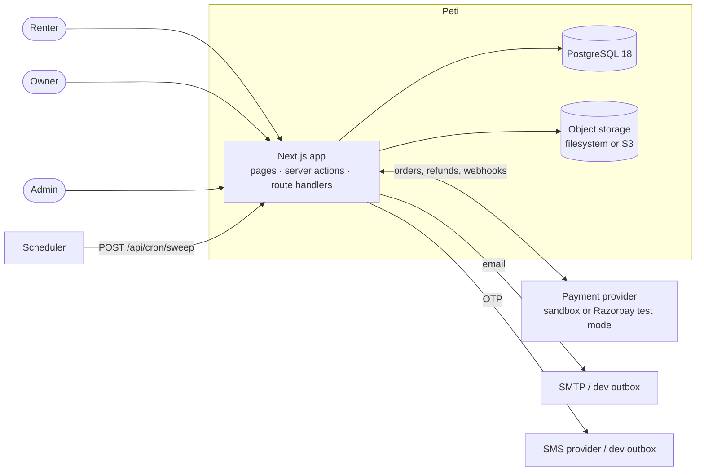
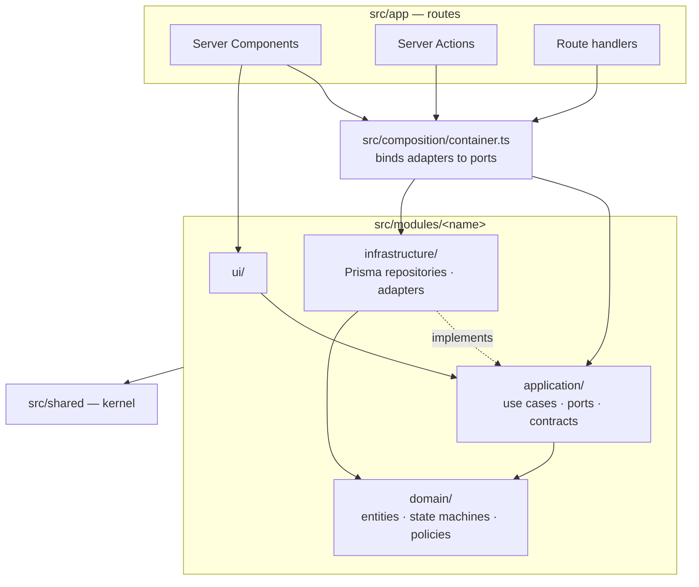

# System architecture

Peti is a **modular monolith**: one Next.js 16 application and one PostgreSQL database. Decision records:
[ADR-001](../decisions/ADR-001-technology-stack.md) (stack), [ADR-002](../decisions/ADR-002-modular-monolith.md)
(module structure).

## Context

There is no queue, cache server or separate API service. Background work (expiring deadlines,
auto-completing returns, sending refunds and notifications) runs in an idempotent **sweep** invoked by a
scheduler (`POST /api/cron/sweep` with a shared secret) or `pnpm jobs:sweep`, using `FOR UPDATE SKIP LOCKED`
so concurrent sweeps never double-process.

## Layers

Rules (enforced by dependency-cruiser in CI): domain is pure; application depends on domain and ports only;
UI never reaches infrastructure; modules import each other only through `index.ts`; routes never import
Prisma; no cycles. See [CLAUDE.md](../../CLAUDE.md#4-architecture-rules-enforced-by-pnpm-boundaries).

## Request paths

**Mutation (Server Action).** Form (React Hook Form + Zod) → `actions.ts` re-parses the same Zod contract →
resolves the actor from the session → rate-limits where relevant → calls one use case from the container →
the use case authorises the actor, applies domain rules and writes through repositories inside a transaction
→ returns `ActionResult<T>` → the action revalidates affected paths.

**Read (Server Component).** Page → query function from the container → Prisma or SQL read model → plain
serialisable DTOs (money as paise numbers, dates as `YYYY-MM-DD` strings).

**Webhook.** Route handler → raw body → provider adapter verifies signature → inbox insert (deduplicated) →
`confirmPayment` / refund handlers.

## Modules

| Module          | Responsibility                                                                                                                                        |
| --------------- | ----------------------------------------------------------------------------------------------------------------------------------------------------- |
| `auth`          | Better Auth configuration, session → actor, sign-up hooks                                                                                             |
| `users`         | Profiles, addresses, contact verification state, identity-verification port (status only)                                                             |
| `listings`      | Outfits, photos, measurements, price options, moderation workflow                                                                                     |
| `search`        | Discovery query (keyword, filters, date availability), category and locality reads, saved outfits                                                     |
| `bookings`      | Request, approve, reject, cancel, handover, return, disputes, owner blocks, sweep; state machine, history, calendar holds and booking-side money rows |
| `payments`      | Provider port and adapters, payment confirmation, webhook inbox, refunds outbox                                                                       |
| `deposits`      | Pure settlement maths (refund, deposit outcome, commission, payout)                                                                                   |
| `reviews`       | Double-blind reviews after completion                                                                                                                 |
| `notifications` | In-app notifications and email/SMS outbox                                                                                                             |
| `media`         | Upload validation, re-encoding, storage port                                                                                                          |
| `admin`         | Metrics, user suspension, payouts, category management, audit log                                                                                     |

## Cross-cutting concerns

- **Configuration:** `src/config/env.ts` validates every variable with Zod and refuses unsafe production
  settings (sandbox payments, dev outbox, local storage).
- **Time:** a `Clock` port; calendar days are `LocalDate` values computed in Asia/Kolkata.
- **Errors:** `DomainError` subclasses with stable codes; Postgres errors mapped centrally.
- **Logging:** structured JSON lines with a request id; no secrets, OTPs or full payment payloads.
- **Security:** see [security-architecture.md](./security-architecture.md).

## Extraction path

If a module later needs to scale or be owned separately (payments is the likeliest), its `index.ts` becomes
a client for a service with the same use-case signatures. The webhook inbox and refunds outbox already
behave like message boundaries.

## Why some planned modules were merged

The plan listed separate `availability`, `disputes` and `categories` modules. In practice calendar holds and
disputes change the booking aggregate inside the same transaction as a status transition, so splitting them
would have meant cross-module transactions; they live in `bookings`. Category reads belong to discovery
(`search`) and category management to `admin`. Payments depends on bookings (never the reverse): the payments
module verifies the provider and then calls `bookings.recordCapturedPayment`, the only path to `CONFIRMED`.
