# Peti — Phase 3 implementation report (the two-sided marketplace)

|                        |                                                                                                                                              |
| ---------------------- | -------------------------------------------------------------------------------------------------------------------------------------------- |
| Dates                  | 2026-11-16 to 2026-11-17                                                                                                                     |
| Scope                  | Phase 3: let every member list their own clothing and rent other members' — the owner listing experience and the renter discovery experience |
| Starting commit        | `4fbeb3d` (Phase 2 report)                                                                                                                   |
| Final code commit      | `4600b99` (CI: §6)                                                                                                                           |
| Decisions by the owner | "What it cost new" stays required. Redeploy the demo, with listing-photo upload unavailable there and saying so                              |

**Bottom line.** A member can now list an outfit in three steps (details, photographs with a chosen cover,
a preview that is the real public page), manage everything they list from My outfits, explore other members'
outfits with categories, filters and lender trust, check availability on the outfit page and start the
existing booking flow — all from one account, with one account bar for renting and lending. No booking,
payment or database schema change was needed. Peti remains a demonstration: the Phase 2 launch blockers
(legal, payments, SMS, tax, operations) are unchanged.

**Evidence tags:** **[TEST]** automated test; **[E2E]** Playwright journey against a production build;
**[RUN]** observed on a running server.

---

## 1. Definition of done

| #   | Requirement                                 | Status | Evidence                                                                                              |
| --- | ------------------------------------------- | ------ | ----------------------------------------------------------------------------------------------------- |
| 1   | A user can list their own clothing          | Done   | [E2E] Journey A; [TEST] draft from the essentials alone                                               |
| 2   | Upload and manage outfit photographs        | Done   | [TEST] uploader component (multi-file, refusal, cover, remove); [E2E] two photographs and a new cover |
| 3   | Preview and publish                         | Done   | [E2E] preview → submit; publishing respects admin approval [TEST]                                     |
| 4   | View and manage own outfits                 | Done   | [TEST] My outfits counts, pause and edit keep bookings; [E2E] pending approval shown                  |
| 5   | Other users discover eligible outfits       | Done   | [TEST] drafts, pending, paused, rejected never shown; resume republishes                              |
| 6   | Search and filter                           | Done   | [TEST] keyword, category, locality, price range, paging; existing size, dates, measurements           |
| 7   | Detailed outfit pages                       | Done   | Gallery, availability, policies, lender [E2E] Journey B                                               |
| 8   | Check availability                          | Done   | Read-only calendar on the outfit page; dates filter in Explore [E2E]                                  |
| 9   | Initiate the existing booking flow          | Done   | [E2E] Journey B sends a request; [TEST] renting another's outfit                                      |
| 10  | Owners and renters use the same account     | Done   | One account bar; [E2E] same seeded members on both sides                                              |
| 11  | Authorisation and ownership enforced        | Done   | §5                                                                                                    |
| 12  | Booking and payment workflows intact        | Done   | Existing booking, payment and Phase 2 suites unchanged and green                                      |
| 13  | Responsive                                  | Done   | Reviewed at 390 px and 1440 px (§4); mobile action bar added                                          |
| 14  | Automated tests cover the new functionality | Done   | §6                                                                                                    |
| 15  | All checks pass                             | Done   | §6                                                                                                    |

---

## 2. What was built

### Navigation and one account

- **Two primary actions.** "Explore outfits" leads the header links; "List an outfit" is the header's only
  filled button (signed out it goes to the lending explainer, signed in straight to the form). On phones a
  slim two-link bar under the header keeps both one tap away; the menu sheet leads with them; the home hero
  offers both.
- **One account bar** across `/account` and `/lend`: My rentals, My outfits, Rental requests, Earnings,
  Saved, Profile & settings, with a quiet second row where a section spans pages (open and past requests;
  profile, notifications, addresses, reviews). No route changed.

### List an outfit (owner)

1. **Details** (`/lend/outfits/new`): the essentials first — name, category, size, description, occasions,
   condition (default Good), prices per rental length with what the owner would receive after the fee, what
   it cost new, deposit with a suggested range, pickup address and locality. Colour, fabric, label, condition
   notes, measurements and cleaning days sit under "More about the outfit", which opens itself on an error.
2. **Photographs** (`/lend/outfits/[id]/photos`, new): drop or choose several; preview and stage per file;
   type and size refused before upload with the reason; remove; **Make cover**.
3. **Preview & submit** (`/lend/outfits/[id]/preview`, new): the real Explore card and outfit page, then
   Submit for review → My outfits with "Submitted for review".

### My outfits

Image-led rows: cover, category, name, lowest price and its length, status in plain words (Draft, Pending
approval, Published, Rejected, Paused, Unavailable) with one line on what it means, the reviewer's note,
requests waiting, upcoming rentals and the next start date, and only the actions the status allows. Pause and
resume stay on the page and confirm.

### Explore outfits and the outfit page (renter)

- A category strip above the existing filters; each card adds the lender ("★ 4.7 · 12 rentals", "3 rentals
  completed" or "New lender") and, when a future date is chosen, "Free from …".
- The outfit page body became one shared component with a **gallery**, a read-only **availability
  calendar**, **How renting works** from the live policy values, and the lender panel. An owner sees "This is
  your outfit" and manage links instead of the request button.
- Home gains "New in the wardrobe" (the six latest published outfits).

---

## 3. Screens and routes

| Route                            | Change                                                           |
| -------------------------------- | ---------------------------------------------------------------- |
| Header, footer, mobile menu      | Explore outfits / List an outfit; mobile action bar              |
| `/`                              | Both actions in the hero; New in the wardrobe                    |
| `/explore`, `/categories/[slug]` | Category strip; lender line and free-dates marker on cards       |
| `/outfits/[slug]`                | Shared detail view: gallery, availability, policies; owner panel |
| `/lend/outfits/new`              | Essentials-first form; step bar                                  |
| `/lend/outfits/[id]/photos`      | **New**: photographs and cover                                   |
| `/lend/outfits/[id]/preview`     | **New**: real card and page, submit                              |
| `/lend/outfits/[id]/edit`        | Step bar for drafts; cover action; links to preview              |
| `/lend/dashboard`                | Rebuilt as My outfits                                            |
| `/account/*`, `/lend/*` layouts  | Shared account bar                                               |

Screenshots (`docs/screenshots/`, captured with `pnpm docs:screenshots` from the seeded data):

| Screen                          | Desktop                                             | Mobile                                      |
| ------------------------------- | --------------------------------------------------- | ------------------------------------------- |
| Home                            | 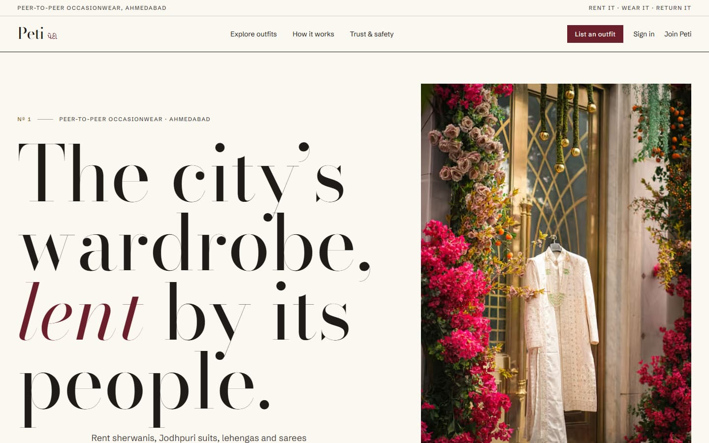                | 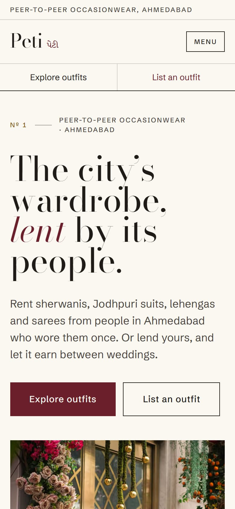         |
| Explore outfits                 | 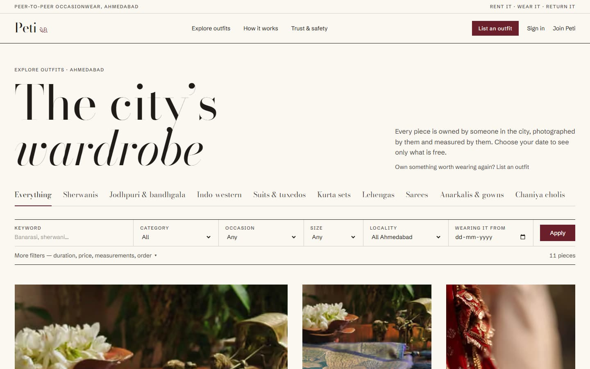             | 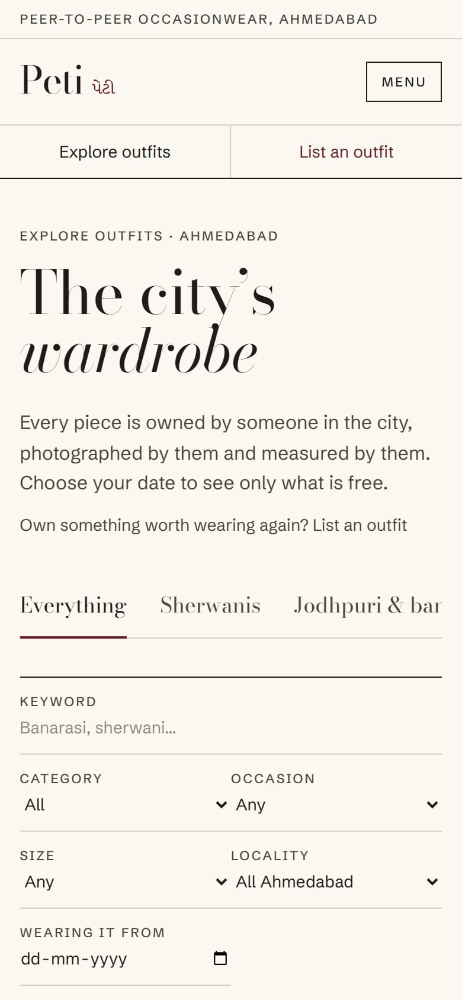      |
| Outfit page                     | 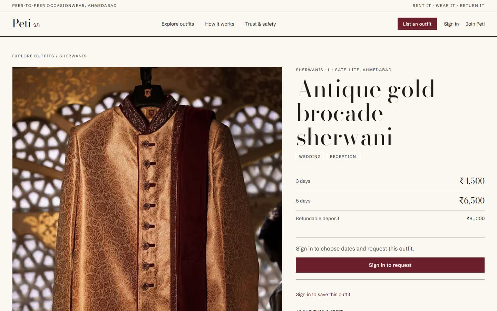              | 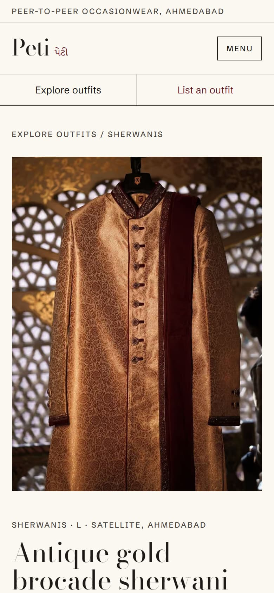       |
| Availability on the outfit page | 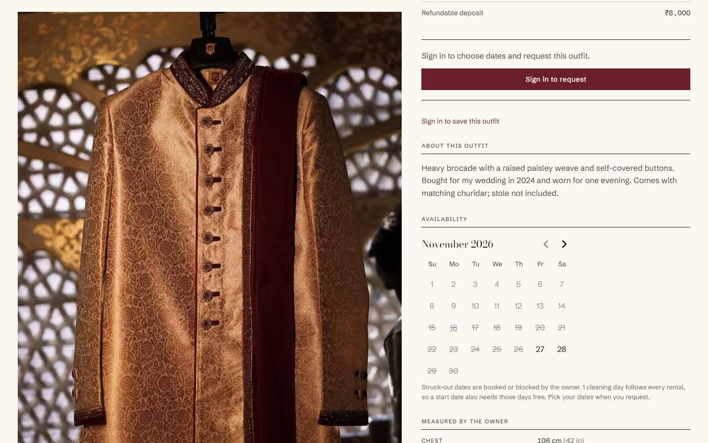 |                                             |
| List an outfit: details         | 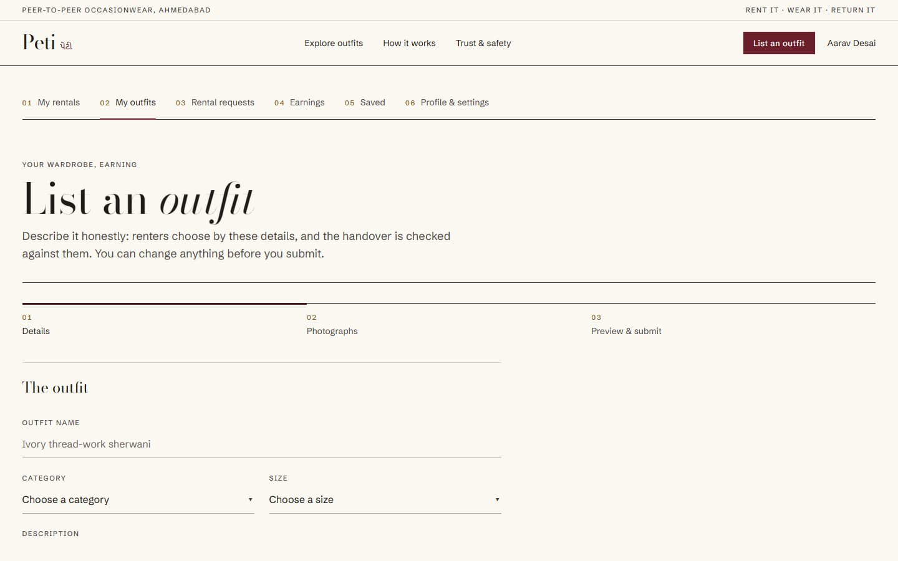        | 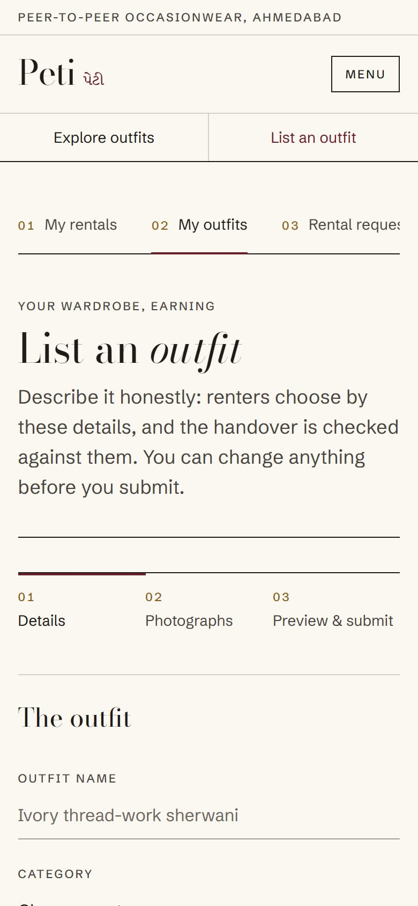 |
| List an outfit: photographs     | 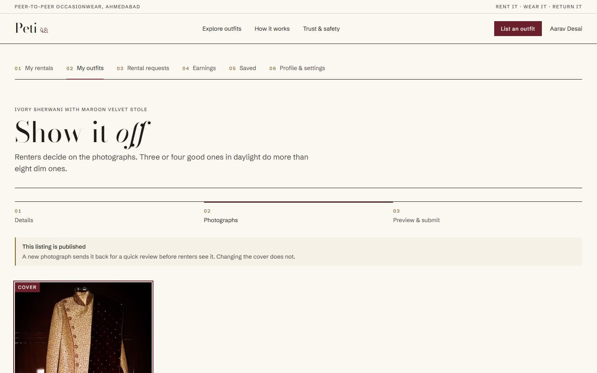         | 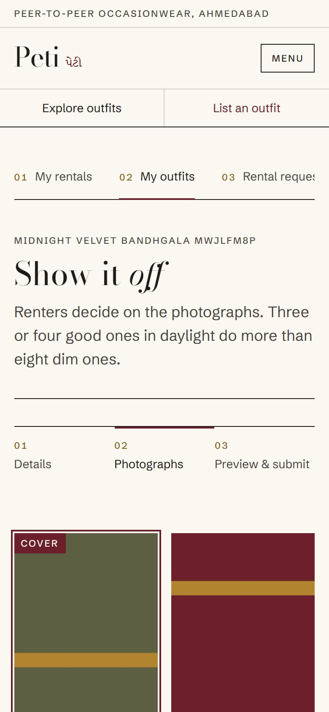  |
| List an outfit: preview         | 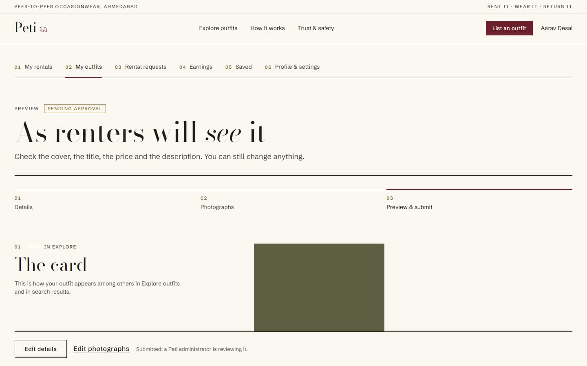        | 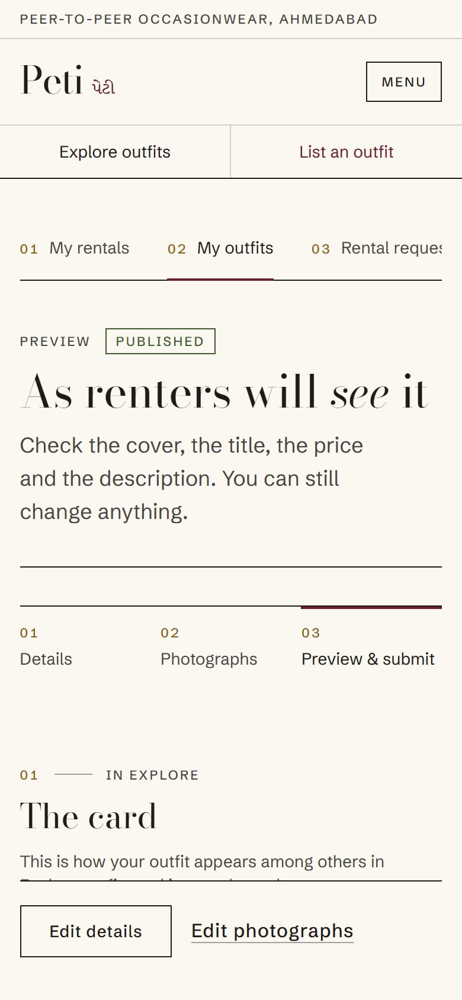 |
| My outfits                      | 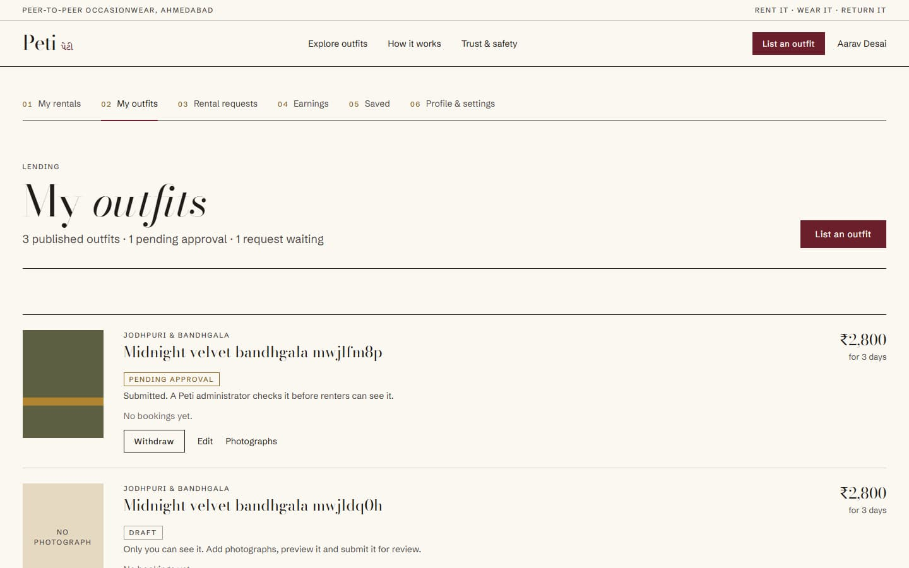          | 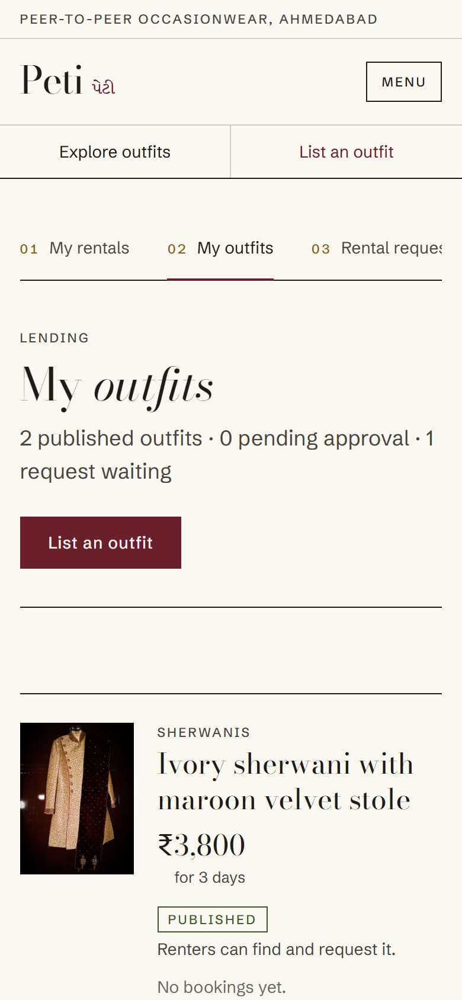   |

---

## 4. Architecture and data

**Database: no migration.** The existing model covered everything ([listing-domain.md](../architecture/listing-domain.md)):

- the cover is the first photograph by `sort_order`, so "Make cover" reorders instead of adding a flag that
  could disagree with the order;
- "original purchase price" is the existing required `retail_value_paise`, shown as "What it cost new",
  because database constraints cap the deposit and prices at it (owner decision);
- statuses already had Draft, Pending, Published, Rejected, Paused and Suspended; only their labels changed;
- the only data change is a seed category, "Other occasionwear".

**Application and service changes**

| Change                                                                                             | Where                                                                |
| -------------------------------------------------------------------------------------------------- | -------------------------------------------------------------------- |
| `setCoverPhoto` use case; `listPhotos`, `setPhotoOrder`                                            | `listings` application and repository                                |
| `listMine` adds requests waiting, upcoming rentals, next start, photo count, lowest price's length | `listings` repository (one grouped query)                            |
| Listing form: condition defaults to Good, notes optional (but meaningful if given)                 | `listingFormSchema`                                                  |
| `allowsPhotoUploads(env)`; `PHOTO_UPLOADS_DISABLED`                                                | `config/env.ts`, `listings` use case                                 |
| Card lender fields; `explore` reports `datesChecked`                                               | `search` query and use case                                          |
| `OutfitDetailView`, `OutfitGallery`, `CategoryStrip`                                               | `search/ui`                                                          |
| `AvailabilityCalendar`, `RentalPolicies`                                                           | `bookings/ui` (composed by pages; `search` never imports `bookings`) |
| Owner notified of approve, reject and suspend (in-app and email)                                   | `listings` admin transitions, through the notifications writer       |
| `setCoverPhotoAction`; `returnTo` on status commands (owner-area paths only)                       | `app/lend/(owner)/actions.ts`, `app/_lib/paths.ts`                   |
| `AccountNav`; `IndexBar` items active across several prefixes                                      | `app/_components`, `shared/ui`                                       |

**Decisions worth recording**

- **Steps as routes, not a client wizard.** Each step is a server page over the same draft, so a refresh, the
  back button or coming back tomorrow lands where the owner was, and no step state lives in the browser.
- **The preview is the page.** It renders the components renters see, with the actions slot replaced.
- **Bookings UI reaches the outfit page through the page.** Module boundaries stay one-way (checked by
  dependency-cruiser).
- **Policies are read, not written.** "How renting works" formats `marketplacePolicy`, the values booking and
  settlement apply, so copy cannot drift from behaviour.

---

## 5. Security and data integrity

| Rule                                                          | Where enforced                                                                                               | Evidence                                                       |
| ------------------------------------------------------------- | ------------------------------------------------------------------------------------------------------------ | -------------------------------------------------------------- |
| Only the owner edits, photographs, reorders, previews, pauses | `owned()` in every owner use case; preview uses `getForEdit`                                                 | [TEST] stranger `FORBIDDEN` for the cover; existing edit tests |
| A cover can only be one of the listing's photographs          | `orderWithCover` returns null → `NOT_FOUND`                                                                  | [TEST]                                                         |
| Prices, deposit, IDs, statuses never trusted                  | Zod contract, money rules, DB constraints; status via server-side transitions only                           | [TEST] invalid prices refused with field errors                |
| No listing reaches renters without approval                   | Status machine; Explore and outfit page require `ACTIVE`                                                     | [TEST]                                                         |
| No self-rental                                                | Request page redirect and `OWN_OUTFIT` in `requestBooking`                                                   | [TEST] [E2E]                                                   |
| Listing changes never touch existing bookings                 | Bookings snapshot price and terms; archive refused with open bookings                                        | [TEST] booking row identical after pause and edit              |
| Uploads checked on the server                                 | Real type from file bytes, size and pixel limits, re-encode (strips location)                                | Existing media tests; [TEST] demo refusal stores nothing       |
| No open redirect from status forms                            | `ownerReturnPath`: `/lend/…` paths only                                                                      | [TEST]                                                         |
| Lender privacy                                                | Cards and pages show name, rating, rentals, verification flags only; calendar shows held days, never by whom | Code review                                                    |

No new public endpoint was added; every new page requires a session and its use case authorises the actor.

---

## 6. Tests and results (2026-11-17)

| Check                       | Result                                                                                                                      |
| --------------------------- | --------------------------------------------------------------------------------------------------------------------------- |
| Lint, types, layer rules    | Pass; 0 violations, 259 modules                                                                                             |
| Unit + component            | **134 / 134** (was 119): uploader 5, policies 1, cover rule 2, tab matching 2, return path 2, lender line 2, demo uploads 1 |
| Integration (PostgreSQL 18) | **131 / 131** (was 116): owner experience 9, marketplace discovery 6 (existing listing suites unchanged)                    |
| Schema drift                | None                                                                                                                        |
| Production build            | Pass                                                                                                                        |
| End to end                  | **14 / 14** (was 11): Journey A, Journey B, owner's own outfit                                                              |
| CI                          | `675c7e2` and `4600b99`: pass on quality, integration and end to end                                                        |

New test files: `tests/integration/listings/owner-experience.test.ts`,
`tests/integration/listings/marketplace-discovery.test.ts`, `tests/component/photo-manager.test.tsx`,
`tests/component/rental-policies.test.tsx`, `tests/unit/search/owner-trust.test.ts`,
`tests/unit/shared/{index-bar,owner-return-path}.test.ts`, `tests/e2e/marketplace.spec.ts`.

**Found and fixed during verification**

- Owners were never told when an administrator published, rejected or suspended their listing, although the
  journeys (and the new "Submitted for review" notice) said they would be. Each decision now sends an in-app
  and email notification with the reviewer's note (`4600b99`, with a test).

- The "Free from" marker appeared for today's or past dates, which Explore does not filter by. The use case
  now reports whether dates were checked (`046e14a`, with a test).
- Journey B first clicked the outfit page's new calendar while navigating to the request page (both share the
  calendar styling); the spec now waits for the request page.
- Screenshots first showed leftover test listings in the local database; they were archived locally and the
  screenshots recaptured.

**Live demo** (`https://peti-kappa.vercel.app`, `4600b99` deployed; no migration needed — the demo database
reported its schema up to date) [RUN]:

| Check                                                          | Result                                                                     |
| -------------------------------------------------------------- | -------------------------------------------------------------------------- |
| `/api/health?ready=1`                                          | `200`, database ok, 7 migrations                                           |
| `/`, `/explore`, a category, `/lend`                           | `200`; "New in the wardrobe" on the home page                              |
| Cards' lender line                                             | "New lender" on all 20 (no demo rental has completed)                      |
| `/lend/dashboard` signed out; `/dev/outbox`                    | Redirect to sign-in; `404`                                                 |
| Journey B and "owner sees their own outfit" (Playwright, live) | **Passed**                                                                 |
| My outfits, preview, photographs as the seeded owner           | Rows shown; preview renders; the demo upload notice replaces the drop zone |

Journey A was not run against the demo: it uploads photographs, which the demo refuses by design. It passes
against a production build locally and in CI.

---

## 7. Known limitations

- **Demo:** listing photographs cannot be uploaded on the public demo (read-only filesystem, no object
  storage); the page says so. Listing details and preview work for seeded outfits. The new "Other
  occasionwear" category exists in seed data only; the demo database was not reseeded, to keep its accounts
  and bookings.
- **Ahmedabad only;** locality is the only location filter.
- **Photographs:** a cover can be chosen, but the rest cannot be reordered; no alt-text editing in the
  uploader (alt text defaults to the outfit name).
- **No public lender profile;** trust shows on cards and the outfit page.
- **Rental requests** are not filtered per outfit from My outfits (the link opens all requests).
- **Availability** on the outfit page shows held days; the full start-date rules (lead time, length, cleaning)
  apply on the request page.

## 8. Remaining product gaps

- Garment measurements beyond the current eight, size charts, fabric/colour/brand as structured filters,
  accessories (extension points in [listing-domain.md](../architecture/listing-domain.md)).
- Owner analytics (views, saves).
- Messaging between renter and owner before a request (out of scope; requests carry a note).
- Everything in the Phase 2 blockers: legal review of the settlement model, live payments, SMS registration,
  tax, production operations. Peti must not take real users or money until those are resolved.
