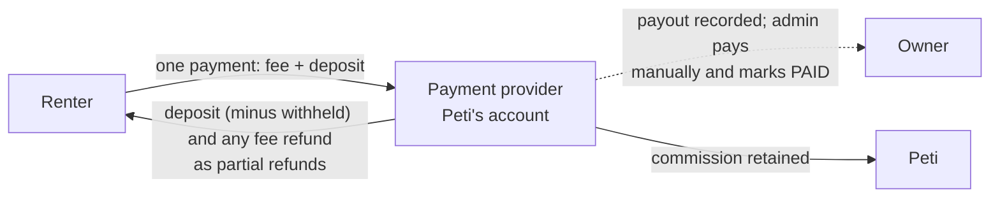

# Business model

How Peti makes money, who pays what, and how each rupee of a booking is split. The mechanics here follow the
settlement rule in [payment architecture](../architecture/payment-architecture.md) and the policy defaults in
the [product requirements](./product-requirements.md#policy-defaults).

> The 15% commission, the cancellation tiers and every other policy value are **launch assumptions**, not
> validated pricing (see [assumptions and risks](./assumptions-and-risks.md)). All figures in this document
> are **illustrative**: they are derived only from those policy defaults applied to a made-up booking. They are
> not forecasts, market data or real transactions. Nothing here is legal, tax or accounting advice.

## 1. The model in one paragraph

Peti is a pure customer-to-customer (C2C) rental marketplace. Individuals in Ahmedabad list occasionwear they
own; other individuals rent it. Peti never owns inventory, never takes custody of a garment and runs no
logistics: handover and return are in person. Peti's role is the transaction layer — on-platform payment and
deposit, request-to-book with owner approval, a calendar that cannot double-book, condition reports,
a fixed dispute process and verified reviews. For that, Peti takes a commission on the rental fee of settled
rentals, charged to the owner side only.

## 2. Who pays what

| Party  | Pays                                                                                      | Receives                                                                                         |
| ------ | ----------------------------------------------------------------------------------------- | ------------------------------------------------------------------------------------------------ |
| Renter | Rental fee + refundable security deposit, as one on-platform payment after owner approval | Deposit back (minus any late fee or agreed/decided damage); fee refunds per cancellation tier    |
| Owner  | Nothing up front. 15% commission is deducted from the rental fee they earn                | Rental fee (or retained part) minus commission, plus any deposit withheld for late fee or damage |
| Peti   | Payment gateway costs and all operating costs (section 8)                                 | 15% of the rental fee actually retained from the renter                                          |

There are no listing fees, subscriptions, renter service fees or vendor fees in the MVP.

The renter's total is exactly rental fee + deposit, and the owner's payout is exactly rental fee minus
commission (plus any withheld deposit). Both identities are enforced on the booking record. It follows that
**Peti absorbs the payment gateway's fees out of its commission**; neither party sees them.

## 3. Money flow

1. After the owner approves, the renter pays rental fee + deposit in one payment through the payment provider.
2. The booking is CONFIRMED only when the provider confirms the capture. The deposit is recorded as HELD.
3. When the booking is settled, a single settlement rule splits the captured amount three ways: refund to the
   renter, payout owed to the owner, and Peti's commission.
4. The renter's refund is sent back through the provider as a partial refund of the original payment.
5. The owner's payout is **recorded, not sent**. In the MVP an admin pays the owner outside Peti (to the UPI ID
   the owner has recorded) and marks the payout PAID with a reference. No money moves automatically to owners.

Holding money for owners and paying it out raises regulatory and tax questions that must be resolved before a
real launch — see [R-02 and R-03](./assumptions-and-risks.md#risk-register).

## 4. Commission mechanics

- **Base:** the rental fee only. Never the deposit.
- **Rate:** 15% (1,500 basis points), snapshotted on each booking at request time so a later change never
  affects an existing booking.
- **Side:** owner side only. The renter pays the listed price; the owner sees their net earnings for each
  duration option while creating the listing and on every request.
- **Rounding:** calculated in integer paise, rounded half up.
- **When it is earned:** only at settlement, on the part of the rental fee that is actually retained.

The settlement rule, for retained fee `F` and withheld deposit `W`:

| Output             | Formula                                          |
| ------------------ | ------------------------------------------------ |
| Refund to renter   | `(rental fee − F) + (deposit − W)`               |
| Commission to Peti | `round_half_up(F × 1500 / 10000)`                |
| Payout to owner    | `F − commission + W`                             |
| Check              | `refund + payout + commission = amount captured` |

### Deposit deductions go to the owner, without commission

When part of the deposit is withheld — for a late fee or for damage or missing items, agreed or decided by an
admin — the whole withheld amount `W` is added to the owner's payout. **Peti takes no commission on it.** The
deposit is compensation for the owner, not rental revenue. A damage claim is capped at the deposit minus any
late fee, so the deposit is the most the platform can recover for an owner.

### Cancellation fee retention, and commission on a retained fee

If a renter cancels a CONFIRMED booking, the deposit is always refunded in full (`W = 0`) and the rental fee is
retained by tier:

| Renter cancels                     | Retained fee `F`   | Commission | Owner payout     |
| ---------------------------------- | ------------------ | ---------- | ---------------- |
| 7 days or more before the start    | 0                  | 0          | 0                |
| Between 48 hours and 7 days before | 50% of rental fee  | 15% of `F` | `F` − commission |
| Less than 48 hours before          | 100% of rental fee | 15% of `F` | `F` − commission |

The retained fee compensates the owner for dates they can no longer easily re-let, so it is treated like
rental revenue: Peti's commission applies to it at the same rate.

If the **owner** cancels after payment, the renter gets everything back, `F = 0`, the owner earns nothing, Peti
earns nothing and the cancellation is counted on the owner's record. Cancellations before payment
(PENDING_APPROVAL, AWAITING_PAYMENT) involve no money.

Where an admin cancels a booking or resolves a dispute, the admin sets `F` and `W` explicitly and the same rule
applies.

## 5. Revenue recognition

Peti counts commission as earned **only when a booking is settled**, never at request, approval or payment:

| Booking outcome                                       | Commission recognised          |
| ----------------------------------------------------- | ------------------------------ |
| COMPLETED (normal return, or after a dispute)         | 15% of the retained rental fee |
| CANCELLED after payment with part of the fee retained | 15% of the retained fee        |
| CANCELLED with a full refund; owner cancellation      | None                           |
| REJECTED, EXPIRED, or cancelled before payment        | None                           |

Until settlement, money captured for a CONFIRMED, ACTIVE, RETURNED or DISPUTED booking is held on behalf of the
renter and owner; none of it is Peti's revenue. The rental fee and deposit are never Peti's revenue at any
point — only the commission is.

This is the product's operating rule for metrics and dashboards. The formal accounting treatment (for example,
whether Peti reports commission only, as an agent, and the tax treatment of it) needs an accountant's
confirmation.

## 6. Worked examples (illustrative)

**Illustrative booking.** All values are invented for arithmetic only, chosen to sit inside the policy defaults:

| Item                                | Value                                                                        |
| ----------------------------------- | ---------------------------------------------------------------------------- |
| Declared retail value               | ₹20,000                                                                      |
| Duration option chosen              | 3 days                                                                       |
| Rental fee                          | ₹6,000                                                                       |
| Deposit                             | ₹5,000 (25% of retail, inside the 20–30% suggestion; above the ₹500 minimum) |
| Renter pays                         | ₹6,000 + ₹5,000 = **₹11,000**                                                |
| Commission at 15%                   | ₹6,000 × 15 ÷ 100 = **₹900**                                                 |
| Daily rate (rental fee ÷ days)      | ₹6,000 ÷ 3 = ₹2,000                                                          |
| Late fee per late day (1.5 × daily) | ₹2,000 × 3 ÷ 2 = ₹3,000                                                      |

(The daily rate definition is an MVP assumption; see open question OQ-3 in the
[PRD](./product-requirements.md#10-open-questions).)

| #   | Scenario                                                              | `F`   | `W`   | Refund to renter            | Commission             | Owner payout                 | Check (refund + payout + commission) |
| --- | --------------------------------------------------------------------- | ----- | ----- | --------------------------- | ---------------------- | ---------------------------- | ------------------------------------ |
| 1   | Returned on time, no claim                                            | 6,000 | 0     | 0 + 5,000 = 5,000           | 900                    | 6,000 − 900 + 0 = 5,100      | 5,000 + 5,100 + 900 = 11,000         |
| 2   | Returned 1 day late                                                   | 6,000 | 3,000 | 0 + (5,000 − 3,000) = 2,000 | 900                    | 6,000 − 900 + 3,000 = 8,100  | 2,000 + 8,100 + 900 = 11,000         |
| 3   | On time; damage claim of ₹1,500 upheld                                | 6,000 | 1,500 | 0 + (5,000 − 1,500) = 3,500 | 900                    | 6,000 − 900 + 1,500 = 6,600  | 3,500 + 6,600 + 900 = 11,000         |
| 4   | Returned 2 days late (2 × 3,000 = 6,000, capped at the 5,000 deposit) | 6,000 | 5,000 | 0 + 0 = 0                   | 900                    | 6,000 − 900 + 5,000 = 10,100 | 0 + 10,100 + 900 = 11,000            |
| 5   | Renter cancels 10 days before                                         | 0     | 0     | 6,000 + 5,000 = 11,000      | 0                      | 0                            | 11,000 + 0 + 0 = 11,000              |
| 6   | Renter cancels 4 days before (50% tier)                               | 3,000 | 0     | 3,000 + 5,000 = 8,000       | 3,000 × 15 ÷ 100 = 450 | 3,000 − 450 = 2,550          | 8,000 + 2,550 + 450 = 11,000         |
| 7   | Renter cancels 1 day before (0% refund tier)                          | 6,000 | 0     | 0 + 5,000 = 5,000           | 900                    | 6,000 − 900 = 5,100          | 5,000 + 5,100 + 900 = 11,000         |
| 8   | Owner cancels after payment                                           | 0     | 0     | 6,000 + 5,000 = 11,000      | 0                      | 0                            | 11,000 + 0 + 0 = 11,000              |

All amounts are in rupees. Notes:

- In example 2 the largest damage claim the owner could still make is deposit − late fee = 5,000 − 3,000 =
  ₹2,000. In example 4 it is 5,000 − 5,000 = ₹0, and the deposit is FORFEITED.
- Commission is ₹900 in every completed scenario: deposit deductions (examples 2–4) raise the owner's payout,
  not Peti's revenue.

### The capture-then-refund cost (illustrative, symbolic)

Peti captures the whole ₹11,000 and later refunds the deposit. Payment gateways commonly charge their fee on
the captured amount and may not return it when a refund is made; the actual terms depend on the provider and
contract and **have not been confirmed** ([R-01](./assumptions-and-risks.md#risk-register)). We do not assume a
rate. Writing `g` for the gateway fee on an ₹11,000 capture:

- Example 1: Peti's commission is ₹900, so its net is `900 − g`. Part of `g` is charged on the ₹5,000 deposit,
  on which Peti earns nothing.
- Examples 5 and 8: Peti earns ₹0 and, if the fee is not returned on refund, its net is `0 − g`: a loss on every
  early renter cancellation and every owner cancellation.

This is why gateway terms on refunds are a launch-blocking question, and why the later options in section 9
include ways to move the deposit off the captured amount.

## 7. Why a commission when local rivals advertise 0%

The two direct competitors in our region, Anokhi Reet and WEVTRA, advertise 0% commission (marketing claims,
[competitor research](./competitor-research.md#summary)). They can, because they do not touch the money:
parties settle rent, deposit, damage and refunds between themselves, and Anokhi Reet's terms say it does not
mediate disputes (VF).

Peti's commission pays for the things those platforms leave to users. Whether users value them enough to pay is
**the central hypothesis of the business**, not a finding:

| What the commission buys                                                        | Hypothesis ([competitor research](./competitor-research.md#differentiation-hypotheses-not-validated)) |
| ------------------------------------------------------------------------------- | ----------------------------------------------------------------------------------------------------- |
| Rent and deposit held and accounted for on-platform; deposit returned by rule   | H1                                                                                                    |
| Request-to-book, fixed durations, automatic cleaning buffer; no chat haggling   | H2                                                                                                    |
| Timestamped condition reports and a fixed, admin-decided dispute process        | H3                                                                                                    |
| A local, low-logistics network, so the take rate does not need to fund couriers | H5                                                                                                    |

Context, not proof: international P2P platforms that do take payment on-platform report total take rates of
roughly 15–30%, often split across both sides (By Rotation, HURR, Pickle, Tulerie; some figures are search
snippets), and SWRL in India states 15% plus GST in its terms and 21% in its FAQ (VF, contradictory). Peti's
15% owner-side-only rate sits at the low end of that range and charges renters nothing extra.

Two consequences to watch:

- **Owners compare net earnings.** An owner on a 0% classifieds app keeps the whole rent. Peti must show the
  owner what they earn after commission before they list (FR-LIST-06), and make the case in terms of deposit
  security and time saved.
- **Disintermediation.** Contact details are revealed on CONFIRMED, so repeat rentals between the same people
  can move off-platform. See [R-12](./assumptions-and-risks.md#risk-register).

## 8. Cost structure (categories only)

No cost figures are estimated here; they depend on provider contracts and volumes we do not have.

| Category                    | What it covers                                                                                                                                   |
| --------------------------- | ------------------------------------------------------------------------------------------------------------------------------------------------ |
| Payment processing          | Gateway fees on captures; fees not returned on refunded deposits; chargebacks and disputes with the provider                                     |
| Marketplace payment product | Any extra fees for a provider's marketplace or split-settlement product, when adopted                                                            |
| Messaging                   | SMS OTPs (per message), DLT registration in India, transactional email                                                                           |
| Infrastructure              | Hosting, PostgreSQL database and backups, object storage and image delivery, domain and TLS, monitoring                                          |
| Operations staff time       | Listing moderation, dispute resolution, manual payouts and refund retries, user support                                                          |
| Legal, tax and compliance   | Terms and privacy drafting, marketplace and payments advice, GST registration and filings, TDS/TCS handling, data protection, company compliance |
| Trust and safety            | Fraud monitoring, losses Peti chooses to absorb, security reviews                                                                                |
| Acquisition                 | Owner recruitment for cold-start supply, local marketing around Navratri and the wedding season                                                  |
| Open-source maintenance     | Reviewing contributions, dependency updates, documentation                                                                                       |

Not in the cost base, by design: inventory, warehousing, cleaning, delivery and pickup. That is the difference
from owned-inventory models; Rent the Runway reported fulfilment costs of 23.6% of revenue in Q4 FY25 (VF,
[competitor research §8](./competitor-research.md#8-international-p2p-for-contrast)).

## 9. Later options (future)

**None of these is in the MVP.** Each is a candidate to evaluate once there is real booking data, and each
would need its own validation and, where noted, legal or partner work.

| Option                      | Idea                                                                                     | Why it might matter                                          | Open issues                                                                         |
| --------------------------- | ---------------------------------------------------------------------------------------- | ------------------------------------------------------------ | ----------------------------------------------------------------------------------- |
| Renter service fee (future) | A small fee on the renter side, as many international platforms charge                   | Lets the owner-side rate stay low; covers gateway costs      | Price sensitivity against 0% rivals; must be shown up front                         |
| Protection add-on (future)  | Optional cover for accidental damage, bought by the renter                               | Could allow lower deposits and less capture-then-refund cost | Needs an insurance partner and regulatory advice; Peti cannot sell insurance itself |
| Featured listings (future)  | Owners pay to appear higher in explore or category pages                                 | Revenue not tied to transactions; helps new owners           | Must be clearly labelled as promoted; risks degrading search quality                |
| Deposit as a hold (future)  | Authorise or mandate the deposit instead of capturing it, where the provider supports it | Removes the fee on refunded deposits                         | Provider and payment-method support; hold durations versus rental length            |
| Automated payouts (future)  | Split settlement through the provider's marketplace product                              | Removes manual work; may be required for compliance          | Provider onboarding of individual owners; tax advice                                |
| Optional logistics (future) | Partner pickup and delivery, priced to the renter                                        | Reaches renters who cannot collect in person                 | Custody and damage-in-transit questions; cost                                       |

## 10. What would make us change the model

| Signal we would watch                                               | Possible change                                                |
| ------------------------------------------------------------------- | -------------------------------------------------------------- |
| Owners decline to list once they see net earnings                   | Lower or split commission; introduce a renter fee instead      |
| Gateway fees on refunded deposits exceed what commission can absorb | Deposit holds; renter fee; minimum rental fee                  |
| Many repeat pairs stop booking on-platform                          | Value for repeat bookings (reviews, protection), not penalties |
| Most cancellations fall in one tier                                 | Revisit tier boundaries, especially in peak season (H6)        |

Related: [assumptions and risks](./assumptions-and-risks.md) · [product requirements](./product-requirements.md)
· [user journeys](./user-journeys.md)
