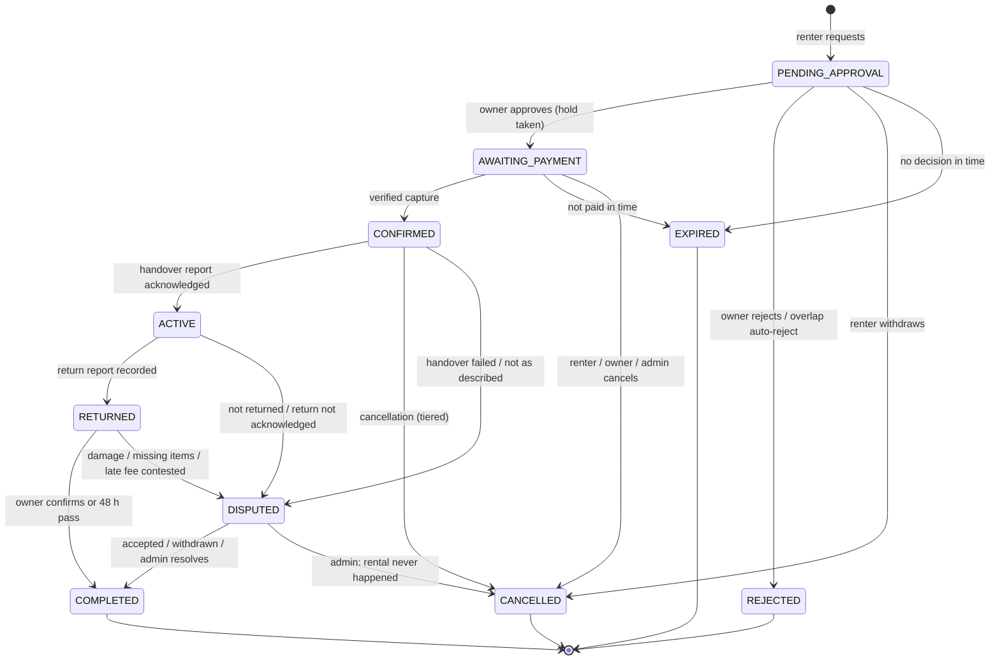

# User journeys

Step-by-step flows for the Peti MVP, naming the page (route) at each step and the booking state change
where there is one. State changes are written `FROM → TO`. All dates and deadlines are in IST.

Related: [product requirements](./product-requirements.md) (requirement IDs) ·
[user personas](./user-personas.md) · [business model](./business-model.md) (worked money examples) ·
[booking lifecycle](../architecture/booking-lifecycle.md) (the authoritative transition table) ·
[payment architecture](../architecture/payment-architecture.md)

Policy values quoted here (windows, tiers, percentages) are MVP defaults and product assumptions, not legal
advice; they are snapshotted on each booking at request time.

## Contents

| Journey | Title                                            | Main persona         |
| ------- | ------------------------------------------------ | -------------------- |
| A       | Registration and contact verification            | Everyone             |
| B       | Listing an outfit                                | P1, P2 (owners)      |
| C       | Discovering outfits                              | P3, P4, P5 (renters) |
| D       | Booking: request, approval, payment              | Renter and owner     |
| E       | Rental lifecycle: cancellation, handover, active | Renter and owner     |
| F       | Return, settlement and review                    | Renter and owner     |
| G       | Admin moderation                                 | P7 (admin)           |
| H       | Dispute resolution                               | Renter, owner, admin |
| I       | Payout recording                                 | Admin, owner         |

## Booking states at a glance

---

## A. Registration and contact verification

**Goal:** a visitor becomes a user with a verified email and phone, ready to rent or lend.

1. The visitor selects "Sign up" on any page and lands on `/sign-up`.
2. They enter name, email and password and accept the current terms and privacy notice (`/terms`,
   `/privacy`). The account is created with the email unverified.
3. Peti sends a verification email. (In local and test environments it appears in `/dev/outbox`.)
4. The user opens the link and lands on `/verify-email`, which confirms the email address is verified.
5. The user signs in at `/sign-in`.
6. On `/account/profile` they set a display name, photo and locality, add an Indian mobile number and request
   a one-time code by SMS. They enter the code; the phone number is marked verified.
7. On `/account/addresses` they add an Ahmedabad address (owners need one as a pickup address).
8. Their public profile shows "Email verified" and "Phone verified". It shows **no** identity badge; the trust
   and safety page explains that Peti does not verify identity.

**Unhappy paths**

| #    | What happens                                                         | Result                                                                                                               |
| ---- | -------------------------------------------------------------------- | -------------------------------------------------------------------------------------------------------------------- |
| A-U1 | Verification link expired or already used                            | `/verify-email` explains and offers to resend.                                                                       |
| A-U2 | Email already registered                                             | A neutral message that does not reveal whether the account exists; the owner of the email can reset the password.    |
| A-U3 | Wrong OTP, or too many OTP requests                                  | Error with remaining attempts; further requests are rate-limited for a period.                                       |
| A-U4 | Forgotten password                                                   | `/forgot-password` → email with a single-use link → `/reset-password` → new password; existing sessions are revoked. |
| A-U5 | User tries to request a booking or submit a listing before verifying | The action is refused with a link to finish verification (FR-AUTH-06/07).                                            |
| A-U6 | Suspended user signs in                                              | They are told the account is suspended and cannot transact.                                                          |

---

## B. Listing an outfit

**Goal:** an owner publishes a garment that renters can book.

1. The owner opens the owner dashboard `/lend` and selects "List an outfit" → `/lend/outfits/new`.
2. They upload at least 3 photos (garment only is recommended), reorder them and pick a cover photo. Location
   data is stripped from the files.
3. They enter title, description, category, occasion tags, size label, measurements, colour, fabric,
   condition, declared retail value, locality and the pickup address.
4. They set a price for one or more duration options (2, 3, 5, 7 days). Next to each, the form shows what they
   would earn after the 15% commission.
5. They set the deposit (₹500 up to the declared retail value; the form suggests 20–30% of retail).
6. They set the turnaround buffer (default 1 day, 0–7 allowed).
7. They save. The listing is `DRAFT` and visible only to them.
8. They select "Submit for review". The listing becomes `PENDING_REVIEW` (requires verified email and phone).
9. An admin reviews it (journey G). On approval it becomes `ACTIVE` and the owner is notified; it now appears
   in explore, its category page and at `/outfits/[slug]`.
10. Optionally, the owner blocks dates when the garment is unavailable on `/lend/outfits/[id]/calendar`.
11. Before their first payout, the owner records a UPI ID for payouts on `/lend/earnings`.

**Unhappy paths**

| #    | What happens                                                 | Result                                                                                                                                                                |
| ---- | ------------------------------------------------------------ | --------------------------------------------------------------------------------------------------------------------------------------------------------------------- |
| B-U1 | Fewer than 3 photos, unsupported file, file too large        | Inline error; the file is rejected before storage.                                                                                                                    |
| B-U2 | Deposit below ₹500 or above retail value; no duration priced | Inline validation error; cannot submit.                                                                                                                               |
| B-U3 | Admin rejects the listing                                    | `REJECTED` with a reason; the owner edits at `/lend/outfits/[id]/edit` and resubmits → `PENDING_REVIEW`.                                                              |
| B-U4 | Owner blocks dates that overlap a booking hold               | Refused: "These dates are booked". Nothing changes.                                                                                                                   |
| B-U5 | Owner blocks dates that overlap pending requests             | Block saved; those requests go `PENDING_APPROVAL → REJECTED` automatically and renters are notified.                                                                  |
| B-U6 | Owner pauses the listing                                     | `PAUSED`: hidden from discovery and cannot be requested; existing confirmed bookings continue.                                                                        |
| B-U7 | Owner edits an ACTIVE listing                                | Price, deposit and buffer changes apply to new requests only. Edits to photos, title, description or category send it back to review (open question OQ-1 in the PRD). |

---

## C. Discovering outfits

**Goal:** a renter finds an outfit that is free on their dates and fits.

1. On the landing page `/`, the renter enters dates and an occasion in the discovery strip, or picks an
   occasion from "browse by occasion".
2. They land on `/explore` with those filters applied. They refine by keyword, category, price, size,
   measurements and locality. Filters are kept in the URL.
3. Outfits whose holds (bookings, owner blocks and buffer days) overlap the dates are not shown.
4. Alternatively, they browse a category at `/categories/[slug]`.
5. They open an outfit at `/outfits/[slug]`: photos, description, measurements, condition, locality, price per
   duration, deposit, buffer, availability calendar, owner profile and reviews. No phone number or address is
   shown.
6. They save the outfit (signing in first if needed, then returning to the page). It appears on
   `/account/saved`.

**Unhappy paths**

| #    | What happens                                    | Result                                                                   |
| ---- | ----------------------------------------------- | ------------------------------------------------------------------------ |
| C-U1 | No results                                      | Suggest removing a filter or widening dates; link to categories.         |
| C-U2 | A saved outfit is paused, suspended or archived | Shown as "No longer available" on `/account/saved`; cannot be requested. |
| C-U3 | Outfit URL for a non-ACTIVE listing             | Not found for everyone except the owner and admins.                      |

---

## D. Booking: request, approval, payment

**Goal:** a renter's request becomes a CONFIRMED booking with the calendar held and payment verified.

1. On `/outfits/[slug]` the renter picks a start date and one duration option. Held, blocked and buffer days
   cannot be selected. The page shows rental fee, refundable deposit and total.
2. They select "Request to book". If not signed in, they sign in and return. If email or phone is unverified,
   they are sent to finish verification (A-U5).
3. They review the rental terms snapshot (cancellation tiers, late fee, inspection window, deposit rules) and
   accept. The request is created: **`∅ → PENDING_APPROVAL`**. Price and policy are frozen. The page shows the
   owner's response deadline (24 hours, or 12:00 IST the day before the start if earlier).
4. The owner is notified and opens `/lend/requests`. They see dates, duration, their earnings after
   commission, and the renter's public profile and reviews.
5. The owner approves: **`PENDING_APPROVAL → AWAITING_PAYMENT`**. The calendar hold for the rental days plus
   buffer is taken in the same step. The payment deadline is set (12 hours, capped at 22:00 IST the day before
   the start).
6. The renter is notified and opens the booking at `/account/rentals/[id]`, then selects "Pay". They go to the
   provider's checkout (in local and test environments, `/dev/sandbox-checkout/[orderId]`).
7. After payment, the provider's signed callback and/or webhook reaches Peti. Peti verifies the signature and
   confirms the capture, amount and currency with the provider: **`AWAITING_PAYMENT → CONFIRMED`**. A security
   deposit record is created as HELD. Overlapping pending requests are auto-rejected.
8. The browser returns to `/account/rentals/[id]`, which reads the confirmed state from the database.
9. Both parties are notified. The booking page now shows each party's phone number and the pickup address.
   They agree a handover time by phone (there is no in-app chat).

**Unhappy paths**

| #     | What happens                                                         | State change and result                                                                                                                                                                                                                                  |
| ----- | -------------------------------------------------------------------- | -------------------------------------------------------------------------------------------------------------------------------------------------------------------------------------------------------------------------------------------------------- |
| D-U1  | Owner rejects                                                        | `PENDING_APPROVAL → REJECTED`, optional reason shown to the renter. No money involved.                                                                                                                                                                   |
| D-U2  | Owner does not respond by the deadline                               | `PENDING_APPROVAL → EXPIRED` by the sweep. Renter notified and pointed to similar outfits.                                                                                                                                                               |
| D-U3  | Renter withdraws the request                                         | `PENDING_APPROVAL → CANCELLED`. No money involved.                                                                                                                                                                                                       |
| D-U4  | Owner approves a request that overlaps another approved booking      | Approval fails with "Dates no longer available"; **no state change**, the request stays `PENDING_APPROVAL`. It is later auto-rejected if the other booking confirms, expires if not decided, or can be approved if the other booking's hold is released. |
| D-U5  | Two owners' devices, or two requests, race to approve the same dates | The database allows exactly one hold; the other approval fails as in D-U4.                                                                                                                                                                               |
| D-U6  | Payment fails or is abandoned at checkout                            | Stays `AWAITING_PAYMENT`; the renter can try again until the payment deadline.                                                                                                                                                                           |
| D-U7  | Payment window passes                                                | The sweep first asks the provider. If paid: `AWAITING_PAYMENT → CONFIRMED`. If not: `AWAITING_PAYMENT → EXPIRED`, hold released, payment marked abandoned, both notified.                                                                                |
| D-U8  | Payment is captured after the booking expired or was cancelled       | The booking stays `EXPIRED` / `CANCELLED`; a full refund is queued automatically and the renter is told.                                                                                                                                                 |
| D-U9  | Renter closes the browser right after paying                         | The webhook confirms the booking anyway; the renter sees CONFIRMED next time they open it.                                                                                                                                                               |
| D-U10 | Duplicate or out-of-order callback and webhook                       | Confirmed at most once; later notifications are no-ops.                                                                                                                                                                                                  |
| D-U11 | Renter or owner cancels while awaiting payment                       | `AWAITING_PAYMENT → CANCELLED`, hold released, nothing charged. A later capture is refunded (D-U8).                                                                                                                                                      |
| D-U12 | Overlapping booking of another renter becomes CONFIRMED              | This renter's request goes `PENDING_APPROVAL → REJECTED` automatically, with an explanation.                                                                                                                                                             |
| D-U13 | Owner blocks the requested dates                                     | `PENDING_APPROVAL → REJECTED` automatically (B-U5).                                                                                                                                                                                                      |

---

## E. Rental lifecycle: cancellation, handover, active

**Goal:** the garment changes hands with its condition on record.

### Handover (happy path)

1. From the day before the start date, the owner's booking page (reached from `/lend/history` or
   `/lend/requests`) offers "Record handover".
2. They meet at the pickup address. The owner photographs the garment (at least 3 photos), notes any existing
   marks or alterations and submits the HANDOVER condition report. It is timestamped and cannot be edited.
3. The renter opens the same booking at `/account/rentals/[id]` on their phone, checks the photos and notes
   against the garment and selects "Acknowledge": **`CONFIRMED → ACTIVE`**.
4. The booking page shows the return date. After the end date passes without a return, it shows "Overdue"
   (a label, not a state; the hold is not extended).

### Cancellation after payment (`CONFIRMED → CANCELLED`)

The renter sees the exact refund before confirming a cancellation. Worked figures are in the
[business model](./business-model.md#6-worked-examples-illustrative).

| Who cancels | When (relative to the rental start, IST) | Rental fee refunded | Deposit refunded | Owner receives                       |
| ----------- | ---------------------------------------- | ------------------- | ---------------- | ------------------------------------ |
| Renter      | 7 days or more before                    | 100%                | 100%             | Nothing                              |
| Renter      | Between 48 hours and 7 days before       | 50%                 | 100%             | Retained 50% of fee minus commission |
| Renter      | Less than 48 hours before                | 0%                  | 100%             | Full fee minus commission            |
| Owner       | Any time after payment                   | 100%                | 100%             | Nothing; cancellation counted        |
| Admin       | Any time, with reason                    | As set by admin     | As set by admin  | As set by admin; audit-logged        |

Steps: the participant opens the booking → "Cancel booking" → sees the tier and amounts → confirms → the
refund is queued, the hold is released, and both parties are notified.

### Unhappy paths

| #    | What happens                                        | State change and result                                                                                                                                                               |
| ---- | --------------------------------------------------- | ------------------------------------------------------------------------------------------------------------------------------------------------------------------------------------- |
| E-U1 | Garment is not as described at handover             | Renter does not acknowledge. On or after the start date, renter opens a "not as described" dispute: `CONFIRMED → DISPUTED` (journey H).                                               |
| E-U2 | Owner does not turn up                              | On or after the start date, renter opens a "handover failed" dispute: `CONFIRMED → DISPUTED`. The expected admin outcome is `DISPUTED → CANCELLED` with a full refund.                |
| E-U3 | Renter does not turn up                             | On or after the start date, owner opens a "handover failed" dispute: `CONFIRMED → DISPUTED`. Admin guideline (an assumption, OQ-4): settle like a renter cancellation under 48 hours. |
| E-U4 | Renter cannot acknowledge (no phone, no signal)     | Admin override after checking with both parties: `CONFIRMED → ACTIVE`, audit-logged.                                                                                                  |
| E-U5 | Owner cancels close to the date                     | `CONFIRMED → CANCELLED`, full refund, counted on the owner's record; renter is pointed to similar outfits.                                                                            |
| E-U6 | Handover attempted more than a day before the start | "Record handover" is not available yet; the parties should meet on or after the day before the start.                                                                                 |

---

## F. Return, settlement and review

**Goal:** the garment comes back, the deposit is settled and both sides review each other.

1. The renter returns the garment in person by the end date.
2. The owner inspects it and records the RETURN condition report with photos:
   **`ACTIVE → RETURNED`**. Peti computes late days (if any) and the late fee (1.5 × daily rate per late day,
   from the deposit, capped at the deposit). The 48-hour inspection window starts.
3. Within the window the owner either:
   - selects "Return is fine": **`RETURNED → COMPLETED`**, or
   - does nothing, and at the deadline the sweep auto-completes: **`RETURNED → COMPLETED`**.
4. Settlement runs: the deposit (minus any late fee) is refunded to the renter, a payout record is created for
   the owner (rental fee minus commission, plus any late fee), and commission is recognised.
5. The renter sees the refund status on `/account/rentals/[id]`. Timing of the money reaching their account
   depends on the provider and their bank.
6. The owner sees the payout as "Owed" on `/lend/earnings`, then "Paid" with a reference once an admin records
   it (journey I).
7. Both are invited to review. Each submits a rating and optional text on the booking page within 14 days.
   Reviews stay hidden until both submit or the window closes, then appear on public profiles and are listed on
   `/account/reviews`.

**Unhappy paths**

| #    | What happens                                                 | State change and result                                                                                                                                 |
| ---- | ------------------------------------------------------------ | ------------------------------------------------------------------------------------------------------------------------------------------------------- |
| F-U1 | Late return                                                  | Recorded at step 2 with late days and late fee. If the renter disagrees, they contest the late fee within the window: `RETURNED → DISPUTED`.            |
| F-U2 | Garment not returned                                         | The owner can open "not returned" at any point after the end date: `ACTIVE → DISPUTED`. If more than 3 days overdue, the system opens it automatically. |
| F-U3 | Renter returned it but the owner has not recorded the return | Renter opens "return not acknowledged": `ACTIVE → DISPUTED`.                                                                                            |
| F-U4 | Damage or missing items                                      | Owner opens a claim within 48 hours with evidence and an amount (at most deposit minus late fee): `RETURNED → DISPUTED` (journey H).                    |
| F-U5 | Owner tries to claim after the window                        | Not possible: the booking is already `COMPLETED` and the deposit settled.                                                                               |
| F-U6 | Damage worth more than the deposit                           | Peti can only recover up to the deposit; anything beyond is outside the platform. This is stated on `/trust-and-safety` and in the terms.               |
| F-U7 | Refund to the renter fails at the provider                   | Shown as pending; retried automatically and visible to admins, who can retry manually (audit-logged).                                                   |
| F-U8 | Booking ended as CANCELLED, REJECTED or EXPIRED              | No review is possible; reviews are only for COMPLETED bookings.                                                                                         |

---

## G. Admin moderation

**Goal:** only suitable listings are discoverable, and bad actors can be stopped.

1. The admin opens the overview `/admin`, which shows counts of pending listings, open disputes, overdue
   rentals, failed refunds and unpaid payouts.
2. They open the queue at `/admin/listings` and select a `PENDING_REVIEW` listing.
3. They check: photos show the garment and no personal information; no phone numbers or addresses in the text
   (which would bypass the contact rule); category and measurements make sense; deposit is within bounds;
   declared retail value is plausible; nothing prohibited.
4. They approve (**listing `PENDING_REVIEW → ACTIVE`**) or reject with a reason (**listing
   `PENDING_REVIEW → REJECTED`**). The owner is notified. The action is audit-logged.
5. For a reported or problematic ACTIVE listing, they suspend it (**listing `ACTIVE → SUSPENDED`**) with a
   reason; it disappears from discovery. Existing confirmed bookings are reviewed case by case on
   `/admin/bookings`.
6. For a problematic user, they suspend the account on `/admin/users`. The user can no longer transact and
   their listings are hidden.
7. They maintain categories on `/admin/categories` (name, slug, order, cover image, hidden or shown).
8. Every one of these actions appears on `/admin/activity` with the admin, time, target and reason.

---

## H. Dispute resolution

**Goal:** a disagreement is settled once, on evidence, within the deposit cap.

1. A dispute is opened (from E-U1/E-U2/E-U3, F-U1/F-U2/F-U3/F-U4) with a reason, description, evidence and, for
   damage, a claimed amount: booking **`→ DISPUTED`**. The other party and admins are notified.
2. The respondent sees the dispute on the booking page and can:
   - accept the claim: **`DISPUTED → COMPLETED`**, the claimed amount is withheld from the deposit; or
   - do nothing or contest, leaving it for the admin.
3. The opener can withdraw: **`DISPUTED → COMPLETED`** with nothing withheld beyond any late fee.
4. Otherwise the admin opens it on `/admin/disputes`. The page shows the HANDOVER and RETURN condition
   reports side by side, the dispute evidence, the booking history and the policy snapshot the renter
   accepted.
5. The admin may phone both parties (contact details are visible to admins). Notes are recorded on the
   dispute.
6. The admin resolves by setting, explicitly:
   - the deposit amount withheld (late fee plus any damage, never more than the deposit), and
   - any rental fee refund (for example, if the garment was not as described),
     with written notes: **`DISPUTED → COMPLETED`**. Or, if the rental never effectively happened (for example
     the owner did not turn up), the admin sets an explicit refund split: **`DISPUTED → CANCELLED`**.
7. Settlement runs with those amounts: refund queued, payout record created, commission on any retained fee.
   The decision is audit-logged and both parties are notified with the outcome and the admin's notes.
8. If the outcome is COMPLETED, the review window opens (journey F, step 7).

---

## I. Payout recording

**Goal:** what Peti owes each owner is recorded and marked paid, with no automated money movement.

1. Each settlement (COMPLETED, or CANCELLED with a retained fee) creates a payout record owed to the owner.
2. The admin opens `/admin/payouts`, filters to outstanding payouts and sees each owner's UPI ID and amount.
3. The admin pays the owner outside Peti, then selects "Mark paid" and enters the payment reference. The
   payout becomes PAID; the action is audit-logged.
4. The owner sees "Paid" and the reference on `/lend/earnings`.

**Unhappy paths**

| #    | What happens                   | Result                                                                                                                                       |
| ---- | ------------------------------ | -------------------------------------------------------------------------------------------------------------------------------------------- |
| I-U1 | Owner has no UPI ID on record  | "Mark paid" is unavailable; the owner is reminded to add one.                                                                                |
| I-U2 | Admin enters a wrong reference | Any correction is itself audit-logged; the audit log is append-only, so the original entry remains. The correction flow is not designed yet. |

The regulatory questions around Peti collecting money and paying it to owners are covered in
[assumptions and risks](./assumptions-and-risks.md#risk-register) (R-02, R-03).
